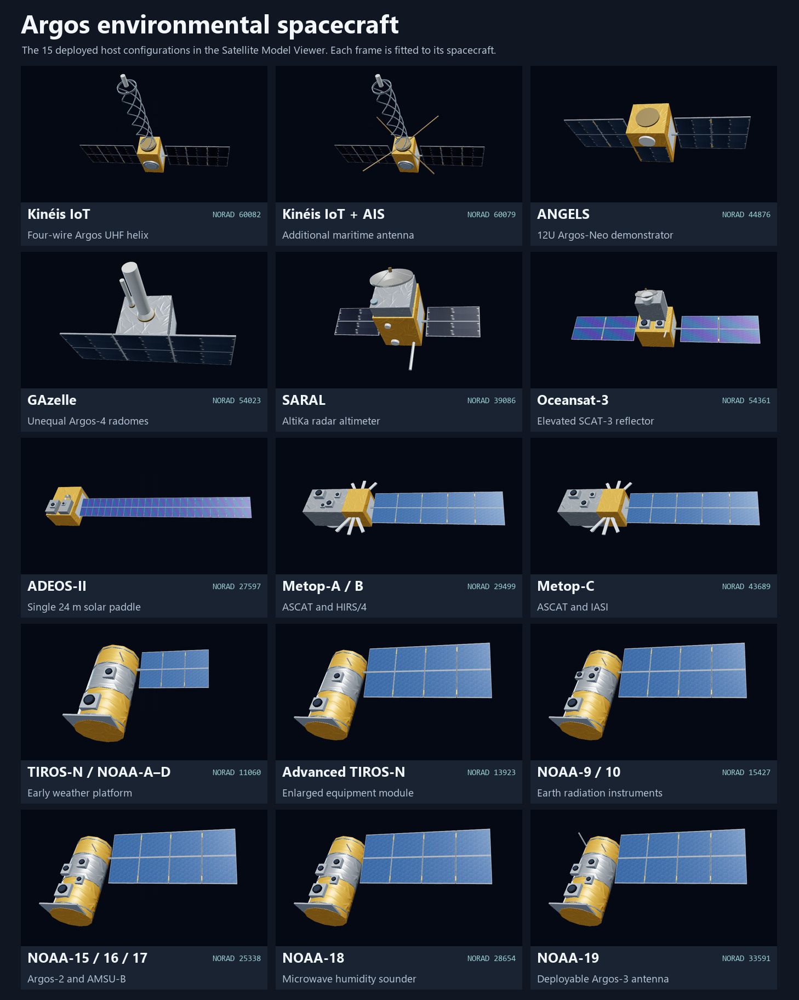

# Argos environmental tracking spacecraft

The bundled catalog contains 49 spacecraft that carried the environmental Argos system or its Kinéis successor. Forty-seven are still in orbit and two are in the historical catalog. All had catalog-outline models at the start of the review. The 15 revised exteriors preserve each host's own instruments and solar array. Select **Argos** on the left of the viewer to browse the fleet. Enable **History** to include ANGELS and NOAA-B. [CNES programme history](https://cnes.fr/en/projects/argos) · [WMO original Argos instrument](https://space.oscar.wmo.int/instruments/view/argos) · [WMO Argos-2 instrument](https://space.oscar.wmo.int/instruments/view/dcs_2)

## What distinguishes the models

The 25 Kinéis spacecraft have a 16U Hemeria bus with two three-panel wings, a four-wire UHF antenna and a stacked S-band terminal. Ten also carry an AIS antenna for maritime signals. The five primary AIS positions in the operator's published constellation diagram are 1B, 2B, 3C, 4D and 5D. Applying the authors' nearest-neighbour rule identifies 1C, 2C, 3D, 4C and 5C as the five backups. Those ten receive the same AIS-equipped exterior. These are hardware assignments based on the published constellation plan. [Kinéis industrial specifications](https://kineis.com/wp-content/uploads/2024/03/2024_07mars_CP-Kineis_industrialisation_BD.pdf#page=3) · [Operator's flight paper, figures 1 and 2](https://publications.spaceops.org/2025/download.php?doc=484__tigy6qgl.pdf#page=3) · [Manufacturer's antenna description](https://www.hemeria-group.com/wp-content/uploads/2021/05/PR-210511-Three-impressive-antennas-for-the-Kin%C3%A9is-nanosatellites.pdf)

The host assignments follow the instrument manifests. Metop-A and B carry HIRS/4. Metop-C shares the ASCAT fan-beam antennas and omits HIRS/4. NOAA-9 and NOAA-10 carry the Earth Radiation Budget Experiment. NOAA-18 carries Argos-2, while NOAA-19 carries the advanced Argos-3 antenna. SARAL, ADEOS-II and Oceansat-3 each have a distinct ocean-observing instrument deck. [Metop layout](https://cnes.fr/sites/default/files/migration/smsc/iasi/PDF/conf2/session1/Cohen.pdf) · [NOAA ERBE flight history](https://pmc.ncbi.nlm.nih.gov/articles/PMC4597424/) · [NOAA-N Prime spacecraft drawing](https://www.ospo.noaa.gov/assets/pdf/NOAA_NP_Booklet.pdf) · [SARAL instrument drawing](https://cnes.fr/projets/saral-altika/satellite-instruments) · [JAXA ADEOS-II flight layout, page 4](https://www.jaxa.jp/press/2003/11/20031107_midori2-01.pdf#page=4) · [ISRO EOS-06 flight layout, page 5](https://www.isro.gov.in/media_isro/pdf/Missions/PSLVC54/PSLVC54_EOS6_BrochureV4.pdf#page=5)

The 1999 US research satellite named ARGOS is a different mission. Metop-SG-A1, the original ADEOS and other satellites sharing the older CubeSat and Indian bus outlines retain their own catalog assignments. ESA's first second-generation Metop platform equipped for Argos is the B-series spacecraft, which has no NORAD record in this snapshot. [NOAA Argos programme](https://www.ospo.noaa.gov/operations/dcs/argos/) · [ESA Metop-SG spacecraft](https://www.esa.int/articles/about-us/directorates/earth-observation-programmes/meteorological-missions/metop-second-generation/metop-sg-satellites)

## Downloads

The GLBs and textured Wavefront archives use metres. Each OBJ archive includes the material library, maps and model notes. An approximation sign marks a catalog estimate or reconstructed extent. NOAA's 6.14 × 2.73 m array and 1.88 m bus diameter are published dimensions. The 8.02 m lateral extent is their sum. Local instrument envelopes, finishes, hinge details and deployment angles are illustrative across these models. [NOAA spacecraft dimensions](https://www.ospo.noaa.gov/assets/pdf/NOAA_NP_Booklet.pdf) · [GCAT dimensional records](https://planet4589.org/space/gcat/tsv/cat/satcat.tsv)

| Exterior | Flights | Span | Payload or distinguishing feature | Files | Source |
| --- | ---: | ---: | --- | --- | --- |
| TIROS-N / NOAA-A–D | 5 | ≈4.9 m | Argos data collection and AVHRR | [GLB](../obj/leo/tiros-n.glb) · [OBJ](../obj/exports/tiros-n.zip) | [NOAA](https://repository.library.noaa.gov/view/noaa/26767/noaa_26767_DS1.pdf) |
| Advanced TIROS-N | 4 | ≈8 m | Argos data collection and weather instruments | [GLB](../obj/leo/ref-atn-13923.glb) · [OBJ](../obj/exports/noaa-atn.zip) | [NOAA](https://repository.library.noaa.gov/view/noaa/26767/noaa_26767_DS1.pdf) |
| NOAA-9 / NOAA-10 with ERBE | 2 | ≈8 m | Argos and Earth Radiation Budget Experiment | [GLB](../obj/leo/noaa-erbe.glb) · [OBJ](../obj/exports/noaa-erbe.zip) | [NOAA](https://repository.library.noaa.gov/view/noaa/26767/noaa_26767_DS1.pdf) |
| NOAA-15 / 16 / 17 | 3 | ≈8 m | Argos-2, AVHRR/3 and microwave sounders | [GLB](../obj/leo/noaa-klm.glb) · [OBJ](../obj/exports/noaa-klm.zip) | [NOAA](https://repository.library.noaa.gov/view/noaa/26767/noaa_26767_DS1.pdf) |
| NOAA-18 | 1 | ≈8.02 m | Argos-2, AVHRR/3 and Microwave Humidity Sounder | [GLB](../obj/leo/noaa-n.glb) · [OBJ](../obj/exports/noaa-n.zip) | [NOAA](https://www.ospo.noaa.gov/assets/pdf/NOAA_NP_Booklet.pdf) |
| NOAA-19 | 1 | ≈8.02 m | Argos-3, AVHRR/3 and Microwave Humidity Sounder | [GLB](../obj/leo/noaa-n-prime.glb) · [OBJ](../obj/exports/noaa-n-prime.zip) | [NOAA](https://www.ospo.noaa.gov/assets/pdf/NOAA_NP_Booklet.pdf) |
| ADEOS-II / Midori II | 1 | 28 m | Advanced Argos DCS, AMSR, SeaWinds, GLI, POLDER and ILAS-II | [GLB](../obj/leo/adeos-ii.glb) · [OBJ](../obj/exports/adeos-ii.zip) | [JAXA](https://www.jaxa.jp/press/2003/11/20031107_midori2-01.pdf) |
| Metop-A / Metop-B | 2 | 17.6 m | Argos-3, ASCAT, IASI and HIRS/4 | [GLB](../obj/leo/metop-ab.glb) · [OBJ](../obj/exports/metop-ab.zip) | [ESA](https://www.esa.int/Applications/Observing_the_Earth/Meteorological_missions/MetOp/Facts_figures) |
| Metop-C | 1 | 17.6 m | Argos-3, ASCAT and IASI | [GLB](../obj/leo/metop-c.glb) · [OBJ](../obj/exports/metop-c.zip) | [ESA](https://www.esa.int/Applications/Observing_the_Earth/Meteorological_missions/MetOp/Facts_figures) |
| SARAL / AltiKa | 1 | ≈4 m | Argos-3 and AltiKa radar altimeter | [GLB](../obj/leo/saral.glb) · [OBJ](../obj/exports/saral.zip) | [ISRO](https://www.isro.gov.in/ISRO_EN/SARAL.html) |
| ANGELS | 1 | ≈1 m | Argos-Neo demonstrator | [GLB](../obj/leo/angels.glb) · [OBJ](../obj/exports/angels.zip) | [CNES](https://cnes.fr/en/projects/angels) |
| GAzelle / OTB-3 | 1 | ≈2 m | Argos-4 and RadMon | [GLB](../obj/leo/ref-gazelle-54023.glb) · [OBJ](../obj/exports/gazelle.zip) | [NOAA](https://www.nesdis.noaa.gov/news/argos-4-completes-latest-milestone-join-argos-fleet) |
| Oceansat-3 / EOS-06 | 1 | ≈11.7 m | Argos-4, SCAT-3, OCM-3 and SSTM | [GLB](../obj/leo/oceansat-3.glb) · [OBJ](../obj/exports/oceansat-3.zip) | [ISRO](https://www.isro.gov.in/media_isro/pdf/Missions/PSLVC54/PSLVC54_EOS6_BrochureV4.pdf#page=5) |
| Kinéis IoT | 15 | 1.6 m | Argos-compatible IoT | [GLB](../obj/leo/kineis-iot.glb) · [OBJ](../obj/exports/kineis-iot.zip) | [Kinéis](https://kineis.com/wp-content/uploads/2024/03/2024_07mars_CP-Kineis_industrialisation_BD.pdf#page=3) |
| Kinéis IoT and AIS | 10 | 1.6 m | Argos-compatible IoT and maritime AIS | [GLB](../obj/leo/kineis-ais.glb) · [OBJ](../obj/exports/kineis-ais.zip) | [Kinéis](https://kineis.com/wp-content/uploads/2024/03/2024_07mars_CP-Kineis_industrialisation_BD.pdf#page=3) |

## Flight inventory

Dates are UTC. The orbital status and decay dates are from the project's 18 November 2026 catalog. Metop-A remains in orbit after its retirement in 2021. ANGELS completed its mission in December 2024 and reentered in 2026. NOAA-B failed to reach an operational orbit. The 1,117 kg entry for EOS-06 is ISRO's separation mass. Other masses use flight or catalog launch records. The ≈ symbol denotes an approximate figure. [EUMETSAT Metop history](https://www.eumetsat.int/our-satellites/metop-series) · [CNES ANGELS mission](https://cnes.fr/en/projects/angels) · [NOAA TIROS-N history](https://repository.library.noaa.gov/view/noaa/26767/noaa_26767_DS1.pdf) · [ISRO EOS-06 launch kit](https://www.isro.gov.in/media_isro/pdf/Missions/PSLVC54/PSLVC54_EOS6_BrochureV4.pdf#page=5) · [GCAT](https://planet4589.org/space/gcat/root.html)

| Catalog spacecraft | NORAD | COSPAR | UTC launch | Orbital status | Mass | Assigned exterior |
| --- | ---: | --- | --- | --- | ---: | --- |
| TIROS N | [11060](../display_satellite.html?norad=11060) | 1978-096A | 1978-10-13 | In orbit | 1,405 kg | TIROS-N / NOAA-A–D |
| NOAA 6 | [11416](../display_satellite.html?norad=11416) | 1979-057A | 1979-06-27 | In orbit | 1,418 kg | TIROS-N / NOAA-A–D |
| NOAA B | [11819](../display_satellite.html?norad=11819) | 1980-043A | 1980-05-29 | Decayed 1981-05-03 | 1,418 kg | TIROS-N / NOAA-A–D |
| NOAA 7 | [12553](../display_satellite.html?norad=12553) | 1981-059A | 1981-06-23 | In orbit | 1,418 kg | TIROS-N / NOAA-A–D |
| NOAA 8 | [13923](../display_satellite.html?norad=13923) | 1983-022A | 1983-03-28 | In orbit | 1,712 kg | Advanced TIROS-N |
| NOAA 9 | [15427](../display_satellite.html?norad=15427) | 1984-123A | 1984-12-12 | In orbit | 1,712 kg | NOAA-9 / NOAA-10 with ERBE |
| NOAA 10 | [16969](../display_satellite.html?norad=16969) | 1986-073A | 1986-09-17 | In orbit | 1,712 kg | NOAA-9 / NOAA-10 with ERBE |
| NOAA 11 | [19531](../display_satellite.html?norad=19531) | 1988-089A | 1988-09-24 | In orbit | 1,712 kg | Advanced TIROS-N |
| NOAA 12 | [21263](../display_satellite.html?norad=21263) | 1991-032A | 1991-05-14 | In orbit | 1,418 kg | TIROS-N / NOAA-A–D |
| NOAA 13 | [22739](../display_satellite.html?norad=22739) | 1993-050A | 1993-08-09 | In orbit | 1,712 kg | Advanced TIROS-N |
| NOAA 14 | [23455](../display_satellite.html?norad=23455) | 1994-089A | 1994-12-30 | In orbit | 1,712 kg | Advanced TIROS-N |
| NOAA 15 | [25338](../display_satellite.html?norad=25338) | 1998-030A | 1998-05-13 | In orbit | 2,232 kg | NOAA-15 / 16 / 17 |
| NOAA 16 | [26536](../display_satellite.html?norad=26536) | 2000-055A | 2000-09-21 | In orbit | 2,231 kg | NOAA-15 / 16 / 17 |
| NOAA 17 | [27453](../display_satellite.html?norad=27453) | 2002-032A | 2002-06-24 | In orbit | 2,231 kg | NOAA-15 / 16 / 17 |
| MIDORI II (ADEOS-II) | [27597](../display_satellite.html?norad=27597) | 2002-056A | 2002-12-14 | In orbit | 3,680 kg | ADEOS-II / Midori II |
| NOAA 18 | [28654](../display_satellite.html?norad=28654) | 2005-018A | 2005-05-20 | In orbit | 1,420 kg | NOAA-18 |
| METOP-A | [29499](../display_satellite.html?norad=29499) | 2006-044A | 2006-10-19 | In orbit | 4,086 kg | Metop-A / Metop-B |
| NOAA 19 | [33591](../display_satellite.html?norad=33591) | 2009-005A | 2009-02-06 | In orbit | ≈1,419.8 kg | NOAA-19 |
| METOP-B | [38771](../display_satellite.html?norad=38771) | 2012-049A | 2012-09-17 | In orbit | 4,086 kg | Metop-A / Metop-B |
| SARAL | [39086](../display_satellite.html?norad=39086) | 2013-009A | 2013-02-25 | In orbit | 407 kg | SARAL / AltiKa |
| METOP-C | [43689](../display_satellite.html?norad=43689) | 2018-087A | 2018-11-07 | In orbit | 4,086 kg | Metop-C |
| ANGELS | [44876](../display_satellite.html?norad=44876) | 2019-092D | 2019-12-18 | Decayed 2026-04-27 | ≈20 kg | ANGELS |
| OTB-3-GAZELLE | [54023](../display_satellite.html?norad=54023) | 2022-127A | 2022-10-07 | In orbit | 118 kg | GAzelle / OTB-3 |
| EOS-6 (OCEANSAT-3) | [54361](../display_satellite.html?norad=54361) | 2022-158A | 2022-11-26 | In orbit | 1,117 kg | Oceansat-3 / EOS-06 |
| KINEIS-1B | [60079](../display_satellite.html?norad=60079) | 2024-114A | 2024-06-20 | In orbit | 28 kg | Kinéis IoT and AIS |
| KINEIS-1C | [60081](../display_satellite.html?norad=60081) | 2024-114C | 2024-06-20 | In orbit | 28 kg | Kinéis IoT and AIS |
| KINEIS-1D | [60082](../display_satellite.html?norad=60082) | 2024-114D | 2024-06-20 | In orbit | 28 kg | Kinéis IoT |
| KINEIS-1E | [60083](../display_satellite.html?norad=60083) | 2024-114E | 2024-06-20 | In orbit | 28 kg | Kinéis IoT |
| KINEIS-1A | [60084](../display_satellite.html?norad=60084) | 2024-114F | 2024-06-20 | In orbit | 28 kg | Kinéis IoT |
| KINEIS-3C | [61220](../display_satellite.html?norad=61220) | 2024-172A | 2024-09-20 | In orbit | 28 kg | Kinéis IoT and AIS |
| KINEIS-3D | [61221](../display_satellite.html?norad=61221) | 2024-172B | 2024-09-20 | In orbit | 28 kg | Kinéis IoT and AIS |
| KINEIS-3E | [61222](../display_satellite.html?norad=61222) | 2024-172C | 2024-09-20 | In orbit | 28 kg | Kinéis IoT |
| KINEIS-3A | [61223](../display_satellite.html?norad=61223) | 2024-172D | 2024-09-20 | In orbit | 28 kg | Kinéis IoT |
| KINEIS-3B | [61224](../display_satellite.html?norad=61224) | 2024-172E | 2024-09-20 | In orbit | 28 kg | Kinéis IoT |
| KINEIS-5C | [62081](../display_satellite.html?norad=62081) | 2024-219A | 2024-11-25 | In orbit | 28 kg | Kinéis IoT and AIS |
| KINEIS-5D | [62082](../display_satellite.html?norad=62082) | 2024-219B | 2024-11-25 | In orbit | 28 kg | Kinéis IoT and AIS |
| KINEIS-5E | [62083](../display_satellite.html?norad=62083) | 2024-219C | 2024-11-25 | In orbit | 28 kg | Kinéis IoT |
| KINEIS-5A | [62084](../display_satellite.html?norad=62084) | 2024-219D | 2024-11-25 | In orbit | 28 kg | Kinéis IoT |
| KINEIS-5B | [62085](../display_satellite.html?norad=62085) | 2024-219E | 2024-11-25 | In orbit | 28 kg | Kinéis IoT |
| KINEIS-2C | [62929](../display_satellite.html?norad=62929) | 2025-028B | 2025-02-08 | In orbit | 28 kg | Kinéis IoT and AIS |
| KINEIS-2D | [62930](../display_satellite.html?norad=62930) | 2025-028C | 2025-02-08 | In orbit | 28 kg | Kinéis IoT |
| KINEIS-2E | [62931](../display_satellite.html?norad=62931) | 2025-028D | 2025-02-08 | In orbit | 28 kg | Kinéis IoT |
| KINEIS-2A | [62932](../display_satellite.html?norad=62932) | 2025-028E | 2025-02-08 | In orbit | 28 kg | Kinéis IoT |
| KINEIS-2B | [62934](../display_satellite.html?norad=62934) | 2025-028G | 2025-02-08 | In orbit | 28 kg | Kinéis IoT and AIS |
| KINEIS-4E | [63300](../display_satellite.html?norad=63300) | 2025-056A | 2025-03-18 | In orbit | 28 kg | Kinéis IoT |
| KINEIS-4C | [63301](../display_satellite.html?norad=63301) | 2025-056B | 2025-03-18 | In orbit | 28 kg | Kinéis IoT and AIS |
| KINEIS-4D | [63302](../display_satellite.html?norad=63302) | 2025-056C | 2025-03-18 | In orbit | 28 kg | Kinéis IoT and AIS |
| KINEIS-4A | [63303](../display_satellite.html?norad=63303) | 2025-056D | 2025-03-18 | In orbit | 28 kg | Kinéis IoT |
| KINEIS-4B | [63304](../display_satellite.html?norad=63304) | 2025-056E | 2025-03-18 | In orbit | 28 kg | Kinéis IoT |
