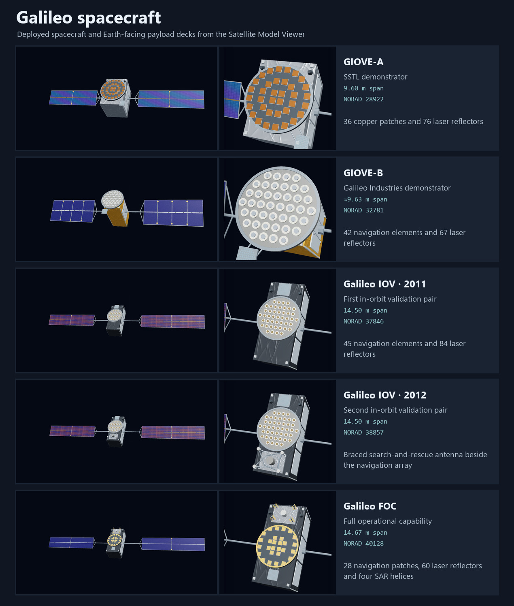

# Galileo navigation spacecraft

The 18 November 2026 catalog contains 36 Galileo spacecraft still in orbit. The two GIOVE demonstrators, four in-orbit validation (IOV) spacecraft and 30 full operational capability (FOC) spacecraft share five deployed exteriors. Matching the catalog number, international designator and permanent spacecraft identifier (SVN) to the 25 November IGS release established the assignment for each flight. [IGS spacecraft identifiers](https://files.igs.org/pub/station/general/igs_satellite_metadata.snx) · [ESA launch record](https://www.esa.int/articles/about-us/directorates/resilience-navigation-and-connectivity/navigation/galileo/galileo-s-launchers)

## Models and downloads

Both formats use metres. Each OBJ archive includes the material library, texture maps and dimensional notes. The viewer has close-ups of the Earth-facing deck, the navigation antenna and the laser reflector. The two designs fitted with search-and-rescue (SAR) equipment also have a dedicated SAR view. [Galileo SAR payload assignments](https://www.gsc-europa.eu/system-service-status/sar-information/sargalileo-satellites-information/sar-payload-characteristics)

| Flight configuration | Spacecraft | Deployed span | Earth-facing hardware | Model downloads |
| --- | ---: | ---: | --- | --- |
| GIOVE-A · Surrey Satellite Technology Ltd | 1 | 9.60 m | 36 copper navigation patches, 76 laser reflector cubes | [GLB](../obj/meo/ref-sstl-600-28922.glb) · [OBJ](../obj/exports/giove-a.zip) |
| GIOVE-B · Galileo Industries, led by Astrium | 1 | ≈9.63 m | 42 navigation elements, 67 laser reflector cubes | [GLB](../obj/meo/ref-proteus-32781.glb) · [OBJ](../obj/exports/giove-b.zip) |
| IOV · 2011 pair · EADS Astrium and Thales Alenia Space | 2 | 14.50 m | 45 navigation elements, 84 laser reflector cubes | [GLB](../obj/meo/galileo-iov.glb) · [OBJ](../obj/exports/galileo-iov.zip) |
| IOV · 2012 pair · EADS Astrium and Thales Alenia Space | 2 | 14.50 m | 45 navigation elements, 84 laser reflector cubes, braced SAR antenna | [GLB](../obj/meo/galileo-iov-sar.glb) · [OBJ](../obj/exports/galileo-iov-sar.zip) |
| FOC · OHB System and SSTL | 30 | 14.67 m | 28 square navigation patches, 60 laser reflector cubes, four SAR receiver helices | [GLB](../obj/meo/galileo-foc.glb) · [OBJ](../obj/exports/galileo-foc.zip) |

The GIOVE-A launch mass was 602 kg. Its wings each carry two 1.74 × 0.98 m panels. GIOVE-B launched at 530 kg and carries four panels per wing. Its span is an estimate obtained by adding two published 4.34 m wings to the 0.95 m bus width. The IGS gives approximately 10 m. The model uses the published stowed envelopes to reconstruct the two prototype buses. [ESA GIOVE-A mission bulletin](https://www.esa.int/esapub/bulletin/bulletin127/bul127i_benedicto.pdf) · [ESA spacecraft reference](https://www.esa.int/esapub/br/br250/br250.pdf#page=154) · [ESA GIOVE mission brochure](https://www.esa.int/esapub/br/br251/br251.pdf) · [IGS dimensions and exterior drawings](https://igs.org/mgex/constellations/#Galileo)

The IOV bus measures 2.611 × 1.149 × 1.149 m and the FOC bus measures 2.530 × 1.200 × 1.100 m in the published spacecraft axes. Each has two 5.000 × 1.082 m solar wings. EUSPA gives typical masses of about 700 kg for IOV and 733 kg for FOC. The viewer provides the catalog launch mass and the flight's dated IGS in-orbit mass where available. [Galileo Service Centre spacecraft metadata](https://www.gsc-europa.eu/support-to-developers/galileo-satellite-metadata) · [EUSPA spacecraft specifications](https://www.euspa.europa.eu/eu-space-programme/galileo/evolution) · [IGS mass records](https://files.igs.org/pub/station/general/igs_satellite_metadata.snx)

The antenna counts and laser reflector apertures follow the published designs. Model coordinates preserve the navigation-to-reflector offsets. Cell spacing, small brackets, blanket finishes and solar-drive angles are visual reconstructions. The models show the exposed navigation hardware seen in the source illustrations. [Navigation antenna study](https://doi.org/10.1007/s00190-016-0909-6) · [Stanford antenna analysis](https://web.stanford.edu/group/scpnt/gpslab/pubs/theses/RamakrishnanThesis_2018.pdf#page=86) · [GIOVE laser reflector specifications](https://ilrs.gsfc.nasa.gov/docs/ESA-EUING-TN-10206_Issue_3.2.pdf) · [ILRS IOV and FOC reflectors](https://ilrs.gsfc.nasa.gov/missions/satellite_missions/current_missions/ga18_reflector.html)

## Flight inventory

Each NORAD number opens the spacecraft in the viewer. The service column gives the Galileo Service Centre's navigation signal status on 26 November 2026. All 36 remain in the orbital catalog, including the four retired or decommissioned vehicles. The first FOC pair, GSAT0201 and GSAT0202, has an elongated orbit and appears under HEO in this catalog. [Galileo constellation status](https://www.gsc-europa.eu/system-service-status/constellation-information) · [ESA corrected orbits](https://www.esa.int/ESA_Multimedia/Images/2015/03/Corrected_orbits)

The Galileo demonstration missions ended in 2012. SSTL used GIOVE-A for additional experiments through 2021. GSAT0104 continued to relay distress signals after losing navigation service and completed decommissioning in April 2025. GSAT0205 was decommissioned in December 2025. [ESA GIOVE history](https://www.esa.int/articles/galileo-prototype-giove-a-switched-off-after-16-years-in-orbit) · [GSC GSAT0104 flight history](https://www.gsc-europa.eu/news/goodbye-galileo-gsat0104) · [GSC GSAT0205 retirement](https://www.gsc-europa.eu/news/gsat0232-becomes-part-of-the-24-nominal-constellation-gsat0205-is-decommissioned)

| Spacecraft | SVN | NORAD | COSPAR | UTC launch | Catalog orbit | Exterior | Navigation service |
| --- | --- | ---: | --- | --- | --- | --- | --- |
| GSAT0001 | E001 | [28922](../display_satellite.html?norad=28922) | 2005-051A | 2005-12-28 | MEO | GIOVE-A | Retired demonstrator |
| GSAT0002 | E002 | [32781](../display_satellite.html?norad=32781) | 2008-020A | 2008-04-26 | MEO | GIOVE-B | Retired demonstrator |
| GSAT0101 | E101 | [37846](../display_satellite.html?norad=37846) | 2011-060A | 2011-10-21 | MEO | IOV 2011 | Usable |
| GSAT0102 | E102 | [37847](../display_satellite.html?norad=37847) | 2011-060B | 2011-10-21 | MEO | IOV 2011 | Usable |
| GSAT0103 | E103 | [38857](../display_satellite.html?norad=38857) | 2012-055A | 2012-10-12 | MEO | IOV 2012 | Usable |
| GSAT0104 | E104 | [38858](../display_satellite.html?norad=38858) | 2012-055B | 2012-10-12 | MEO | IOV 2012 | Decommissioned |
| GSAT0201 | E201 | [40128](../display_satellite.html?norad=40128) | 2014-050A | 2014-08-22 | HEO | FOC | Not Usable |
| GSAT0202 | E202 | [40129](../display_satellite.html?norad=40129) | 2014-050B | 2014-08-22 | HEO | FOC | Not Usable |
| GSAT0203 | E203 | [40544](../display_satellite.html?norad=40544) | 2015-017A | 2015-03-27 | MEO | FOC | Usable |
| GSAT0204 | E204 | [40545](../display_satellite.html?norad=40545) | 2015-017B | 2015-03-27 | MEO | FOC | Not Usable |
| GSAT0205 | E205 | [40889](../display_satellite.html?norad=40889) | 2015-045A | 2015-09-11 | MEO | FOC | Decommissioned |
| GSAT0206 | E206 | [40890](../display_satellite.html?norad=40890) | 2015-045B | 2015-09-11 | MEO | FOC | Usable |
| GSAT0209 | E209 | [41174](../display_satellite.html?norad=41174) | 2015-079A | 2015-12-17 | MEO | FOC | Not Usable |
| GSAT0208 | E208 | [41175](../display_satellite.html?norad=41175) | 2015-079B | 2015-12-17 | MEO | FOC | Usable |
| GSAT0211 | E211 | [41549](../display_satellite.html?norad=41549) | 2016-030A | 2016-05-24 | MEO | FOC | Usable |
| GSAT0210 | E210 | [41550](../display_satellite.html?norad=41550) | 2016-030B | 2016-05-24 | MEO | FOC | Not Usable |
| GSAT0207 | E207 | [41859](../display_satellite.html?norad=41859) | 2016-069A | 2016-11-17 | MEO | FOC | Usable |
| GSAT0212 | E212 | [41860](../display_satellite.html?norad=41860) | 2016-069B | 2016-11-17 | MEO | FOC | Usable |
| GSAT0213 | E213 | [41861](../display_satellite.html?norad=41861) | 2016-069C | 2016-11-17 | MEO | FOC | Usable |
| GSAT0214 | E214 | [41862](../display_satellite.html?norad=41862) | 2016-069D | 2016-11-17 | MEO | FOC | Usable |
| GSAT0215 | E215 | [43055](../display_satellite.html?norad=43055) | 2017-079A | 2017-12-12 | MEO | FOC | Usable |
| GSAT0216 | E216 | [43056](../display_satellite.html?norad=43056) | 2017-079B | 2017-12-12 | MEO | FOC | Usable |
| GSAT0217 | E217 | [43057](../display_satellite.html?norad=43057) | 2017-079C | 2017-12-12 | MEO | FOC | Usable |
| GSAT0218 | E218 | [43058](../display_satellite.html?norad=43058) | 2017-079D | 2017-12-12 | MEO | FOC | Usable |
| GSAT0221 | E221 | [43564](../display_satellite.html?norad=43564) | 2018-060A | 2018-07-25 | MEO | FOC | Usable |
| GSAT0222 | E222 | [43565](../display_satellite.html?norad=43565) | 2018-060B | 2018-07-25 | MEO | FOC | Usable |
| GSAT0219 | E219 | [43566](../display_satellite.html?norad=43566) | 2018-060C | 2018-07-25 | MEO | FOC | Usable |
| GSAT0220 | E220 | [43567](../display_satellite.html?norad=43567) | 2018-060D | 2018-07-25 | MEO | FOC | Usable |
| GSAT0223 | E223 | [49809](../display_satellite.html?norad=49809) | 2021-116A | 2021-12-05 | MEO | FOC | Usable |
| GSAT0224 | E224 | [49810](../display_satellite.html?norad=49810) | 2021-116B | 2021-12-05 | MEO | FOC | Usable |
| GSAT0225 | E225 | [59598](../display_satellite.html?norad=59598) | 2024-079A | 2024-04-28 | MEO | FOC | Usable |
| GSAT0227 | E227 | [59600](../display_satellite.html?norad=59600) | 2024-079C | 2024-04-28 | MEO | FOC | Usable |
| GSAT0232 | E232 | [61182](../display_satellite.html?norad=61182) | 2024-167A | 2024-09-17 | MEO | FOC | Usable |
| GSAT0226 | E226 | [61183](../display_satellite.html?norad=61183) | 2024-167B | 2024-09-17 | MEO | FOC | Usable |
| GSAT0233 | E233 | [67160](../display_satellite.html?norad=67160) | 2025-302A | 2025-12-17 | MEO | FOC | Usable |
| GSAT0234 | E234 | [67162](../display_satellite.html?norad=67162) | 2025-302C | 2025-12-17 | MEO | FOC | Usable |
