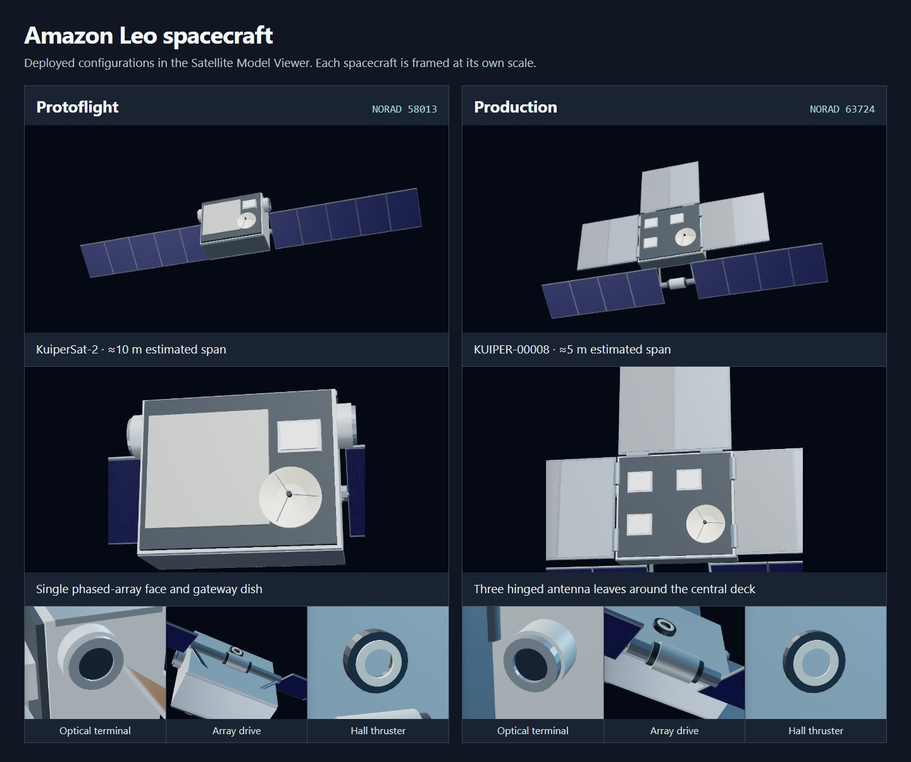

# Amazon Leo (Project Kuiper) spacecraft

The November 18, 2026 bundled catalog contains 398 Kuiper spacecraft. Two were Protoflight vehicles and 396 were production satellites. The LE-04 launch on November 24 added 36 production spacecraft. Matching names, NORAD numbers and international designators against the November 26 SATCAT gives **434 spacecraft that reached orbit**. At that date 428 remained in orbit and six had reentered. The 40 satellites lost on the November 15 Vulcan launch never entered orbital inventory. [Amazon mission log](https://www.aboutamazon.com/news/innovation-at-amazon/project-kuiper-satellite-rocket-launch-progress-updates) · [Arianespace LE-04 deployment](https://newsroom.arianespace.com/arianespace-successfully-launches-another-36-amazon-leo-satellites-on-ariane-6s-10th-flight/?lang=eng) · [CelesTrak Kuiper SATCAT records](https://celestrak.org/satcat/records.php?NAME=KUIPER&FORMAT=JSON)

## Two flown configurations

The existing registry assigned both families correctly. The review preserved their deployed layouts, refined the surface finishes and equipment housings, and added close-ups and textured Wavefront downloads. Each configuration shares one physical model across its NORAD IDs. In the viewer, search for **Amazon Leo** or **Kuiper**. Enable **Include history** to find the two prototypes and four reentered production spacecraft.

| Flight configuration | Catalog length × diameter | Deployed span | Catalog mass | Viewer and downloads |
| --- | ---: | ---: | ---: | --- |
| Protoflight · 2 flights | ≈2.0 × 2.0 m | ≈10 m | ≈600 kg | [KuiperSat-2](../display_satellite.html?norad=58013) · [GLB](../obj/leo/ref-kuiper-58013.glb) · [OBJ/MTL and textures](../obj/exports/kuiper-protoflight.zip) |
| First-generation production · 432 flights through LE-04 | ≈1.8 × 0.7 m | ≈5 m | ≈490 kg | [KUIPER-00008](../display_satellite.html?norad=63724) · [GLB](../obj/leo/kuiper-production.glb) · [OBJ/MTL and textures](../obj/exports/kuiper-production.zip) |

GCAT supplies the representative dimensions and flags its launch and dry masses as estimates. Amazon gives a lower bound of 1,000 lb (about 454 kg) for a production spacecraft built in Kirkland, Washington. Both export formats use metres. [GCAT satellite catalog and flags](https://planet4589.org/space/gcat/tsv/cat/satcat.tsv) · [Amazon manufacturing account](https://www.aboutamazon.com/stories/how-amazon-leo-builds-satellites)

Amazon’s **Protoflight** photograph shows a deployed solar panel and part of the chassis. The model depicts an exposed equipment deck, a phased array, a gateway dish and the articulated solar array. Amazon demonstrated a 100 Gbit/s optical link between KuiperSat-1 and KuiperSat-2 and flew a krypton Hall-effect thruster on each. Equipment positions and the unseen portions of the two vehicles share a representative reconstruction. [Amazon flight photograph](https://www.aboutamazon.com/news/innovation-at-amazon/amazon-project-kuiper-deorbit-satellites) · [Optical-link demonstration](https://www.aboutamazon.com/news/innovation-at-amazon/amazon-project-kuiper-oisl-space-laser-december-2023-update) · [Protoflight propulsion tests](https://www.aboutamazon.com/news/innovation-at-amazon/amazon-project-kuiper-satellite-propulsion-system-november-2023-update)

On the **production spacecraft**, three hinged antenna leaves form an Earth-facing deck around the equipment section. A separate solar array rotates on an offset shaft. This layout follows Mallama and colleagues’ interpretation of Amazon’s deployment imagery. Amazon confirms the dielectric mirror film, phased-array user antennas, parabolic gateway antennas, optical links and krypton propulsion. The model illustrates film coverage, panel seams, terminal positions and a single solar-drive angle. The design orbit shells are 590, 610 and 630 km. [Flight imagery](https://www.aboutamazon.com/news/innovation-at-amazon/project-kuiper-photos-internet-satellite-first-launch) · [Deployed-layout reconstruction, figure 4](https://arxiv.org/pdf/2601.07708#page=4) · [Amazon coating description](https://www.aboutamazon.com/news/innovation-at-amazon/project-kuiper-satellite-internet-first-launch) · [Manufacturing account](https://www.aboutamazon.com/stories/how-amazon-leo-builds-satellites) · [FCC constellation authorization](https://docs.fcc.gov/public/attachments/FCC-20-102A1_Rcd.pdf)

## Viewer checks

All 434 NORAD selections opened the expected model and displayed the matching spacecraft name and international designator. The 398 bundled records were checked in the shipped catalog. The other 36 were checked in a separate catalog built from the published LE-04 SATCAT and orbital-element records. For each selection, the viewer and catalog API agreed on the model and its downloads. The front, side and five hardware views opened. The GLB and Wavefront mesh counts, triangles, materials and deployed spans also passed comparison for both exteriors. [LE-04 SATCAT records](https://celestrak.org/satcat/records.php?INTDES=2026-264&FORMAT=JSON) · [LE-04 orbital elements](https://celestrak.org/NORAD/elements/gp.php?INTDES=2026-264&FORMAT=JSON)

The production optical-terminal camera looks beneath the adjacent antenna leaf. On the prototype, the solar shaft clears the thruster outlet. [Production optical terminal](../display_satellite.html?norad=63724&detail=optical-terminal) · [Prototype thruster](../display_satellite.html?norad=58013&detail=hall-thruster) · [Gateway dish](../display_satellite.html?norad=63724&detail=gateway-dish)

## Flight inventory

The bundled NORAD numbers link to the viewer. The international designator in every row links to its individual SATCAT record. **Model updated** identifies a flight whose existing shared exterior was refined. **Assignment corrected** identifies an LE-04 flight that now resolves to the reviewed production model when its payload record is present in a refreshed catalog.

The status column records reentry and flags the two spacecraft that SATCAT marked partially operational or nonoperational. The November 26 Kuiper orbital-element group contained 427 of the 428 spacecraft then in orbit. KUIPER-00158 (65776) remained in SATCAT with a nonoperational status and had no entry in that group. [SATCAT status codes](https://celestrak.org/satcat/status.php) · [Kuiper orbital-element group](https://celestrak.org/NORAD/elements/gp.php?GROUP=kuiper&FORMAT=JSON)

### Protoflight · 2 spacecraft

| Spacecraft | NORAD | COSPAR / source | Launch (UTC) | Status on Nov 26 | Review outcome |
| --- | ---: | --- | --- | --- | --- |
| KuiperSat-2 (KUIPER-P2) | [58013](../display_satellite.html?norad=58013) | [2023-154A](https://celestrak.org/satcat/records.php?CATNR=58013&FORMAT=JSON) | 2023-10-06 | Reentered 2025-04-29 | Model updated |
| KuiperSat-1 (KUIPER-P1) | [58014](../display_satellite.html?norad=58014) | [2023-154B](https://celestrak.org/satcat/records.php?CATNR=58014&FORMAT=JSON) | 2023-10-06 | Reentered 2024-09-29 | Model updated |

### Bundled production flights · 396 spacecraft

#### KA-01 · 2025-04-28 · 27 spacecraft

| Spacecraft | NORAD | COSPAR / source | Launch (UTC) | Status on Nov 26 | Review outcome |
| --- | ---: | --- | --- | --- | --- |
| KUIPER-00008 | [63724](../display_satellite.html?norad=63724) | [2025-088A](https://celestrak.org/satcat/records.php?CATNR=63724&FORMAT=JSON) | 2025-04-28 | In orbit | Model updated |
| KUIPER-00009 | [63725](../display_satellite.html?norad=63725) | [2025-088B](https://celestrak.org/satcat/records.php?CATNR=63725&FORMAT=JSON) | 2025-04-28 | In orbit | Model updated |
| KUIPER-00010 | [63726](../display_satellite.html?norad=63726) | [2025-088C](https://celestrak.org/satcat/records.php?CATNR=63726&FORMAT=JSON) | 2025-04-28 | In orbit | Model updated |
| KUIPER-00011 | [63727](../display_satellite.html?norad=63727) | [2025-088D](https://celestrak.org/satcat/records.php?CATNR=63727&FORMAT=JSON) | 2025-04-28 | In orbit | Model updated |
| KUIPER-00012 | [63728](../display_satellite.html?norad=63728) | [2025-088E](https://celestrak.org/satcat/records.php?CATNR=63728&FORMAT=JSON) | 2025-04-28 | In orbit | Model updated |
| KUIPER-00013 | [63729](../display_satellite.html?norad=63729) | [2025-088F](https://celestrak.org/satcat/records.php?CATNR=63729&FORMAT=JSON) | 2025-04-28 | In orbit | Model updated |
| KUIPER-00014 | [63730](../display_satellite.html?norad=63730) | [2025-088G](https://celestrak.org/satcat/records.php?CATNR=63730&FORMAT=JSON) | 2025-04-28 | In orbit | Model updated |
| KUIPER-00015 | [63731](../display_satellite.html?norad=63731) | [2025-088H](https://celestrak.org/satcat/records.php?CATNR=63731&FORMAT=JSON) | 2025-04-28 | In orbit | Model updated |
| KUIPER-00016 | [63732](../display_satellite.html?norad=63732) | [2025-088J](https://celestrak.org/satcat/records.php?CATNR=63732&FORMAT=JSON) | 2025-04-28 | In orbit | Model updated |
| KUIPER-00018 | [63733](../display_satellite.html?norad=63733) | [2025-088K](https://celestrak.org/satcat/records.php?CATNR=63733&FORMAT=JSON) | 2025-04-28 | In orbit | Model updated |
| KUIPER-00019 | [63734](../display_satellite.html?norad=63734) | [2025-088L](https://celestrak.org/satcat/records.php?CATNR=63734&FORMAT=JSON) | 2025-04-28 | In orbit | Model updated |
| KUIPER-00020 | [63735](../display_satellite.html?norad=63735) | [2025-088M](https://celestrak.org/satcat/records.php?CATNR=63735&FORMAT=JSON) | 2025-04-28 | In orbit | Model updated |
| KUIPER-00021 | [63736](../display_satellite.html?norad=63736) | [2025-088N](https://celestrak.org/satcat/records.php?CATNR=63736&FORMAT=JSON) | 2025-04-28 | In orbit | Model updated |
| KUIPER-00023 | [63737](../display_satellite.html?norad=63737) | [2025-088P](https://celestrak.org/satcat/records.php?CATNR=63737&FORMAT=JSON) | 2025-04-28 | In orbit | Model updated |
| KUIPER-00024 | [63738](../display_satellite.html?norad=63738) | [2025-088Q](https://celestrak.org/satcat/records.php?CATNR=63738&FORMAT=JSON) | 2025-04-28 | In orbit | Model updated |
| KUIPER-00025 | [63739](../display_satellite.html?norad=63739) | [2025-088R](https://celestrak.org/satcat/records.php?CATNR=63739&FORMAT=JSON) | 2025-04-28 | In orbit | Model updated |
| KUIPER-00027 | [63740](../display_satellite.html?norad=63740) | [2025-088S](https://celestrak.org/satcat/records.php?CATNR=63740&FORMAT=JSON) | 2025-04-28 | In orbit | Model updated |
| KUIPER-00028 | [63741](../display_satellite.html?norad=63741) | [2025-088T](https://celestrak.org/satcat/records.php?CATNR=63741&FORMAT=JSON) | 2025-04-28 | In orbit | Model updated |
| KUIPER-00029 | [63742](../display_satellite.html?norad=63742) | [2025-088U](https://celestrak.org/satcat/records.php?CATNR=63742&FORMAT=JSON) | 2025-04-28 | In orbit | Model updated |
| KUIPER-00030 | [63743](../display_satellite.html?norad=63743) | [2025-088V](https://celestrak.org/satcat/records.php?CATNR=63743&FORMAT=JSON) | 2025-04-28 | In orbit | Model updated |
| KUIPER-00031 | [63744](../display_satellite.html?norad=63744) | [2025-088W](https://celestrak.org/satcat/records.php?CATNR=63744&FORMAT=JSON) | 2025-04-28 | In orbit | Model updated |
| KUIPER-00032 | [63745](../display_satellite.html?norad=63745) | [2025-088X](https://celestrak.org/satcat/records.php?CATNR=63745&FORMAT=JSON) | 2025-04-28 | In orbit | Model updated |
| KUIPER-00033 | [63746](../display_satellite.html?norad=63746) | [2025-088Y](https://celestrak.org/satcat/records.php?CATNR=63746&FORMAT=JSON) | 2025-04-28 | In orbit | Model updated |
| KUIPER-00034 | [63747](../display_satellite.html?norad=63747) | [2025-088Z](https://celestrak.org/satcat/records.php?CATNR=63747&FORMAT=JSON) | 2025-04-28 | In orbit | Model updated |
| KUIPER-00035 | [63748](../display_satellite.html?norad=63748) | [2025-088AA](https://celestrak.org/satcat/records.php?CATNR=63748&FORMAT=JSON) | 2025-04-28 | In orbit | Model updated |
| KUIPER-00037 | [63749](../display_satellite.html?norad=63749) | [2025-088AB](https://celestrak.org/satcat/records.php?CATNR=63749&FORMAT=JSON) | 2025-04-28 | In orbit | Model updated |
| KUIPER-00038 | [63750](../display_satellite.html?norad=63750) | [2025-088AC](https://celestrak.org/satcat/records.php?CATNR=63750&FORMAT=JSON) | 2025-04-28 | In orbit | Model updated |

#### KA-02 · 2025-06-23 · 27 spacecraft

| Spacecraft | NORAD | COSPAR / source | Launch (UTC) | Status on Nov 26 | Review outcome |
| --- | ---: | --- | --- | --- | --- |
| KUIPER-00039 | [64500](../display_satellite.html?norad=64500) | [2025-134A](https://celestrak.org/satcat/records.php?CATNR=64500&FORMAT=JSON) | 2025-06-23 | In orbit | Model updated |
| KUIPER-00040 | [64501](../display_satellite.html?norad=64501) | [2025-134B](https://celestrak.org/satcat/records.php?CATNR=64501&FORMAT=JSON) | 2025-06-23 | In orbit | Model updated |
| KUIPER-00041 | [64502](../display_satellite.html?norad=64502) | [2025-134C](https://celestrak.org/satcat/records.php?CATNR=64502&FORMAT=JSON) | 2025-06-23 | In orbit | Model updated |
| KUIPER-00042 | [64503](../display_satellite.html?norad=64503) | [2025-134D](https://celestrak.org/satcat/records.php?CATNR=64503&FORMAT=JSON) | 2025-06-23 | In orbit | Model updated |
| KUIPER-00043 | [64504](../display_satellite.html?norad=64504) | [2025-134E](https://celestrak.org/satcat/records.php?CATNR=64504&FORMAT=JSON) | 2025-06-23 | In orbit | Model updated |
| KUIPER-00044 | [64505](../display_satellite.html?norad=64505) | [2025-134F](https://celestrak.org/satcat/records.php?CATNR=64505&FORMAT=JSON) | 2025-06-23 | In orbit | Model updated |
| KUIPER-00046 | [64506](../display_satellite.html?norad=64506) | [2025-134G](https://celestrak.org/satcat/records.php?CATNR=64506&FORMAT=JSON) | 2025-06-23 | In orbit | Model updated |
| KUIPER-00047 | [64507](../display_satellite.html?norad=64507) | [2025-134H](https://celestrak.org/satcat/records.php?CATNR=64507&FORMAT=JSON) | 2025-06-23 | In orbit | Model updated |
| KUIPER-00048 | [64508](../display_satellite.html?norad=64508) | [2025-134J](https://celestrak.org/satcat/records.php?CATNR=64508&FORMAT=JSON) | 2025-06-23 | In orbit | Model updated |
| KUIPER-00049 | [64509](../display_satellite.html?norad=64509) | [2025-134K](https://celestrak.org/satcat/records.php?CATNR=64509&FORMAT=JSON) | 2025-06-23 | In orbit | Model updated |
| KUIPER-00050 | [64510](../display_satellite.html?norad=64510) | [2025-134L](https://celestrak.org/satcat/records.php?CATNR=64510&FORMAT=JSON) | 2025-06-23 | In orbit · partially operational | Model updated |
| KUIPER-00051 | [64511](../display_satellite.html?norad=64511) | [2025-134M](https://celestrak.org/satcat/records.php?CATNR=64511&FORMAT=JSON) | 2025-06-23 | In orbit | Model updated |
| KUIPER-00052 | [64512](../display_satellite.html?norad=64512) | [2025-134N](https://celestrak.org/satcat/records.php?CATNR=64512&FORMAT=JSON) | 2025-06-23 | Reentered 2026-03-02 | Model updated |
| KUIPER-00053 | [64513](../display_satellite.html?norad=64513) | [2025-134P](https://celestrak.org/satcat/records.php?CATNR=64513&FORMAT=JSON) | 2025-06-23 | In orbit | Model updated |
| KUIPER-00054 | [64514](../display_satellite.html?norad=64514) | [2025-134Q](https://celestrak.org/satcat/records.php?CATNR=64514&FORMAT=JSON) | 2025-06-23 | In orbit | Model updated |
| KUIPER-00055 | [64515](../display_satellite.html?norad=64515) | [2025-134R](https://celestrak.org/satcat/records.php?CATNR=64515&FORMAT=JSON) | 2025-06-23 | In orbit | Model updated |
| KUIPER-00056 | [64516](../display_satellite.html?norad=64516) | [2025-134S](https://celestrak.org/satcat/records.php?CATNR=64516&FORMAT=JSON) | 2025-06-23 | In orbit | Model updated |
| KUIPER-00057 | [64517](../display_satellite.html?norad=64517) | [2025-134T](https://celestrak.org/satcat/records.php?CATNR=64517&FORMAT=JSON) | 2025-06-23 | In orbit | Model updated |
| KUIPER-00058 | [64518](../display_satellite.html?norad=64518) | [2025-134U](https://celestrak.org/satcat/records.php?CATNR=64518&FORMAT=JSON) | 2025-06-23 | In orbit | Model updated |
| KUIPER-00059 | [64519](../display_satellite.html?norad=64519) | [2025-134V](https://celestrak.org/satcat/records.php?CATNR=64519&FORMAT=JSON) | 2025-06-23 | In orbit | Model updated |
| KUIPER-00060 | [64520](../display_satellite.html?norad=64520) | [2025-134W](https://celestrak.org/satcat/records.php?CATNR=64520&FORMAT=JSON) | 2025-06-23 | In orbit | Model updated |
| KUIPER-00061 | [64521](../display_satellite.html?norad=64521) | [2025-134X](https://celestrak.org/satcat/records.php?CATNR=64521&FORMAT=JSON) | 2025-06-23 | In orbit | Model updated |
| KUIPER-00062 | [64522](../display_satellite.html?norad=64522) | [2025-134Y](https://celestrak.org/satcat/records.php?CATNR=64522&FORMAT=JSON) | 2025-06-23 | In orbit | Model updated |
| KUIPER-00063 | [64523](../display_satellite.html?norad=64523) | [2025-134Z](https://celestrak.org/satcat/records.php?CATNR=64523&FORMAT=JSON) | 2025-06-23 | In orbit | Model updated |
| KUIPER-00064 | [64524](../display_satellite.html?norad=64524) | [2025-134AA](https://celestrak.org/satcat/records.php?CATNR=64524&FORMAT=JSON) | 2025-06-23 | In orbit | Model updated |
| KUIPER-00065 | [64525](../display_satellite.html?norad=64525) | [2025-134AB](https://celestrak.org/satcat/records.php?CATNR=64525&FORMAT=JSON) | 2025-06-23 | In orbit | Model updated |
| KUIPER-00066 | [64526](../display_satellite.html?norad=64526) | [2025-134AC](https://celestrak.org/satcat/records.php?CATNR=64526&FORMAT=JSON) | 2025-06-23 | In orbit | Model updated |

#### KF-01 · 2025-07-16 · 24 spacecraft

| Spacecraft | NORAD | COSPAR / source | Launch (UTC) | Status on Nov 26 | Review outcome |
| --- | ---: | --- | --- | --- | --- |
| KUIPER-00069 | [64816](../display_satellite.html?norad=64816) | [2025-151A](https://celestrak.org/satcat/records.php?CATNR=64816&FORMAT=JSON) | 2025-07-16 | In orbit | Model updated |
| KUIPER-00070 | [64817](../display_satellite.html?norad=64817) | [2025-151B](https://celestrak.org/satcat/records.php?CATNR=64817&FORMAT=JSON) | 2025-07-16 | In orbit | Model updated |
| KUIPER-00071 | [64818](../display_satellite.html?norad=64818) | [2025-151C](https://celestrak.org/satcat/records.php?CATNR=64818&FORMAT=JSON) | 2025-07-16 | In orbit | Model updated |
| KUIPER-00072 | [64819](../display_satellite.html?norad=64819) | [2025-151D](https://celestrak.org/satcat/records.php?CATNR=64819&FORMAT=JSON) | 2025-07-16 | In orbit | Model updated |
| KUIPER-00073 | [64820](../display_satellite.html?norad=64820) | [2025-151E](https://celestrak.org/satcat/records.php?CATNR=64820&FORMAT=JSON) | 2025-07-16 | In orbit | Model updated |
| KUIPER-00074 | [64821](../display_satellite.html?norad=64821) | [2025-151F](https://celestrak.org/satcat/records.php?CATNR=64821&FORMAT=JSON) | 2025-07-16 | Reentered 2026-07-28 | Model updated |
| KUIPER-00075 | [64822](../display_satellite.html?norad=64822) | [2025-151G](https://celestrak.org/satcat/records.php?CATNR=64822&FORMAT=JSON) | 2025-07-16 | In orbit | Model updated |
| KUIPER-00076 | [64823](../display_satellite.html?norad=64823) | [2025-151H](https://celestrak.org/satcat/records.php?CATNR=64823&FORMAT=JSON) | 2025-07-16 | In orbit | Model updated |
| KUIPER-00077 | [64824](../display_satellite.html?norad=64824) | [2025-151J](https://celestrak.org/satcat/records.php?CATNR=64824&FORMAT=JSON) | 2025-07-16 | In orbit | Model updated |
| KUIPER-00078 | [64825](../display_satellite.html?norad=64825) | [2025-151K](https://celestrak.org/satcat/records.php?CATNR=64825&FORMAT=JSON) | 2025-07-16 | In orbit | Model updated |
| KUIPER-00079 | [64826](../display_satellite.html?norad=64826) | [2025-151L](https://celestrak.org/satcat/records.php?CATNR=64826&FORMAT=JSON) | 2025-07-16 | In orbit | Model updated |
| KUIPER-00080 | [64827](../display_satellite.html?norad=64827) | [2025-151M](https://celestrak.org/satcat/records.php?CATNR=64827&FORMAT=JSON) | 2025-07-16 | In orbit | Model updated |
| KUIPER-00082 | [64828](../display_satellite.html?norad=64828) | [2025-151N](https://celestrak.org/satcat/records.php?CATNR=64828&FORMAT=JSON) | 2025-07-16 | In orbit | Model updated |
| KUIPER-00083 | [64829](../display_satellite.html?norad=64829) | [2025-151P](https://celestrak.org/satcat/records.php?CATNR=64829&FORMAT=JSON) | 2025-07-16 | In orbit | Model updated |
| KUIPER-00084 | [64830](../display_satellite.html?norad=64830) | [2025-151Q](https://celestrak.org/satcat/records.php?CATNR=64830&FORMAT=JSON) | 2025-07-16 | In orbit | Model updated |
| KUIPER-00085 | [64831](../display_satellite.html?norad=64831) | [2025-151R](https://celestrak.org/satcat/records.php?CATNR=64831&FORMAT=JSON) | 2025-07-16 | In orbit | Model updated |
| KUIPER-00086 | [64832](../display_satellite.html?norad=64832) | [2025-151S](https://celestrak.org/satcat/records.php?CATNR=64832&FORMAT=JSON) | 2025-07-16 | In orbit | Model updated |
| KUIPER-00087 | [64833](../display_satellite.html?norad=64833) | [2025-151T](https://celestrak.org/satcat/records.php?CATNR=64833&FORMAT=JSON) | 2025-07-16 | In orbit | Model updated |
| KUIPER-00089 | [64834](../display_satellite.html?norad=64834) | [2025-151U](https://celestrak.org/satcat/records.php?CATNR=64834&FORMAT=JSON) | 2025-07-16 | In orbit | Model updated |
| KUIPER-00090 | [64835](../display_satellite.html?norad=64835) | [2025-151V](https://celestrak.org/satcat/records.php?CATNR=64835&FORMAT=JSON) | 2025-07-16 | In orbit | Model updated |
| KUIPER-00091 | [64836](../display_satellite.html?norad=64836) | [2025-151W](https://celestrak.org/satcat/records.php?CATNR=64836&FORMAT=JSON) | 2025-07-16 | In orbit | Model updated |
| KUIPER-00092 | [64837](../display_satellite.html?norad=64837) | [2025-151X](https://celestrak.org/satcat/records.php?CATNR=64837&FORMAT=JSON) | 2025-07-16 | In orbit | Model updated |
| KUIPER-00093 | [64838](../display_satellite.html?norad=64838) | [2025-151Y](https://celestrak.org/satcat/records.php?CATNR=64838&FORMAT=JSON) | 2025-07-16 | In orbit | Model updated |
| KUIPER-00094 | [64839](../display_satellite.html?norad=64839) | [2025-151Z](https://celestrak.org/satcat/records.php?CATNR=64839&FORMAT=JSON) | 2025-07-16 | In orbit | Model updated |

#### KF-02 · 2025-08-11 · 24 spacecraft

| Spacecraft | NORAD | COSPAR / source | Launch (UTC) | Status on Nov 26 | Review outcome |
| --- | ---: | --- | --- | --- | --- |
| KUIPER-00081 | [65132](../display_satellite.html?norad=65132) | [2025-171A](https://celestrak.org/satcat/records.php?CATNR=65132&FORMAT=JSON) | 2025-08-11 | In orbit | Model updated |
| KUIPER-00088 | [65133](../display_satellite.html?norad=65133) | [2025-171B](https://celestrak.org/satcat/records.php?CATNR=65133&FORMAT=JSON) | 2025-08-11 | In orbit | Model updated |
| KUIPER-00095 | [65134](../display_satellite.html?norad=65134) | [2025-171C](https://celestrak.org/satcat/records.php?CATNR=65134&FORMAT=JSON) | 2025-08-11 | In orbit | Model updated |
| KUIPER-00096 | [65135](../display_satellite.html?norad=65135) | [2025-171D](https://celestrak.org/satcat/records.php?CATNR=65135&FORMAT=JSON) | 2025-08-11 | In orbit | Model updated |
| KUIPER-00097 | [65136](../display_satellite.html?norad=65136) | [2025-171E](https://celestrak.org/satcat/records.php?CATNR=65136&FORMAT=JSON) | 2025-08-11 | In orbit | Model updated |
| KUIPER-00098 | [65137](../display_satellite.html?norad=65137) | [2025-171F](https://celestrak.org/satcat/records.php?CATNR=65137&FORMAT=JSON) | 2025-08-11 | In orbit | Model updated |
| KUIPER-00099 | [65138](../display_satellite.html?norad=65138) | [2025-171G](https://celestrak.org/satcat/records.php?CATNR=65138&FORMAT=JSON) | 2025-08-11 | In orbit | Model updated |
| KUIPER-00100 | [65139](../display_satellite.html?norad=65139) | [2025-171H](https://celestrak.org/satcat/records.php?CATNR=65139&FORMAT=JSON) | 2025-08-11 | In orbit | Model updated |
| KUIPER-00102 | [65140](../display_satellite.html?norad=65140) | [2025-171J](https://celestrak.org/satcat/records.php?CATNR=65140&FORMAT=JSON) | 2025-08-11 | In orbit | Model updated |
| KUIPER-00103 | [65141](../display_satellite.html?norad=65141) | [2025-171K](https://celestrak.org/satcat/records.php?CATNR=65141&FORMAT=JSON) | 2025-08-11 | In orbit | Model updated |
| KUIPER-00104 | [65142](../display_satellite.html?norad=65142) | [2025-171L](https://celestrak.org/satcat/records.php?CATNR=65142&FORMAT=JSON) | 2025-08-11 | In orbit | Model updated |
| KUIPER-00105 | [65143](../display_satellite.html?norad=65143) | [2025-171M](https://celestrak.org/satcat/records.php?CATNR=65143&FORMAT=JSON) | 2025-08-11 | In orbit | Model updated |
| KUIPER-00106 | [65144](../display_satellite.html?norad=65144) | [2025-171N](https://celestrak.org/satcat/records.php?CATNR=65144&FORMAT=JSON) | 2025-08-11 | In orbit | Model updated |
| KUIPER-00107 | [65145](../display_satellite.html?norad=65145) | [2025-171P](https://celestrak.org/satcat/records.php?CATNR=65145&FORMAT=JSON) | 2025-08-11 | In orbit | Model updated |
| KUIPER-00108 | [65146](../display_satellite.html?norad=65146) | [2025-171Q](https://celestrak.org/satcat/records.php?CATNR=65146&FORMAT=JSON) | 2025-08-11 | In orbit | Model updated |
| KUIPER-00109 | [65147](../display_satellite.html?norad=65147) | [2025-171R](https://celestrak.org/satcat/records.php?CATNR=65147&FORMAT=JSON) | 2025-08-11 | In orbit | Model updated |
| KUIPER-00110 | [65148](../display_satellite.html?norad=65148) | [2025-171S](https://celestrak.org/satcat/records.php?CATNR=65148&FORMAT=JSON) | 2025-08-11 | In orbit | Model updated |
| KUIPER-00111 | [65149](../display_satellite.html?norad=65149) | [2025-171T](https://celestrak.org/satcat/records.php?CATNR=65149&FORMAT=JSON) | 2025-08-11 | In orbit | Model updated |
| KUIPER-00112 | [65150](../display_satellite.html?norad=65150) | [2025-171U](https://celestrak.org/satcat/records.php?CATNR=65150&FORMAT=JSON) | 2025-08-11 | In orbit | Model updated |
| KUIPER-00114 | [65151](../display_satellite.html?norad=65151) | [2025-171V](https://celestrak.org/satcat/records.php?CATNR=65151&FORMAT=JSON) | 2025-08-11 | In orbit | Model updated |
| KUIPER-00115 | [65152](../display_satellite.html?norad=65152) | [2025-171W](https://celestrak.org/satcat/records.php?CATNR=65152&FORMAT=JSON) | 2025-08-11 | In orbit | Model updated |
| KUIPER-00116 | [65153](../display_satellite.html?norad=65153) | [2025-171X](https://celestrak.org/satcat/records.php?CATNR=65153&FORMAT=JSON) | 2025-08-11 | In orbit | Model updated |
| KUIPER-00118 | [65154](../display_satellite.html?norad=65154) | [2025-171Y](https://celestrak.org/satcat/records.php?CATNR=65154&FORMAT=JSON) | 2025-08-11 | In orbit | Model updated |
| KUIPER-00119 | [65155](../display_satellite.html?norad=65155) | [2025-171Z](https://celestrak.org/satcat/records.php?CATNR=65155&FORMAT=JSON) | 2025-08-11 | In orbit | Model updated |

#### KA-03 · 2025-09-25 · 27 spacecraft

| Spacecraft | NORAD | COSPAR / source | Launch (UTC) | Status on Nov 26 | Review outcome |
| --- | ---: | --- | --- | --- | --- |
| KUIPER-00120 | [65762](../display_satellite.html?norad=65762) | [2025-217A](https://celestrak.org/satcat/records.php?CATNR=65762&FORMAT=JSON) | 2025-09-25 | In orbit | Model updated |
| KUIPER-00132 | [65763](../display_satellite.html?norad=65763) | [2025-217B](https://celestrak.org/satcat/records.php?CATNR=65763&FORMAT=JSON) | 2025-09-25 | In orbit | Model updated |
| KUIPER-00133 | [65764](../display_satellite.html?norad=65764) | [2025-217C](https://celestrak.org/satcat/records.php?CATNR=65764&FORMAT=JSON) | 2025-09-25 | In orbit | Model updated |
| KUIPER-00139 | [65765](../display_satellite.html?norad=65765) | [2025-217D](https://celestrak.org/satcat/records.php?CATNR=65765&FORMAT=JSON) | 2025-09-25 | In orbit | Model updated |
| KUIPER-00142 | [65766](../display_satellite.html?norad=65766) | [2025-217E](https://celestrak.org/satcat/records.php?CATNR=65766&FORMAT=JSON) | 2025-09-25 | In orbit | Model updated |
| KUIPER-00145 | [65767](../display_satellite.html?norad=65767) | [2025-217F](https://celestrak.org/satcat/records.php?CATNR=65767&FORMAT=JSON) | 2025-09-25 | In orbit | Model updated |
| KUIPER-00147 | [65768](../display_satellite.html?norad=65768) | [2025-217G](https://celestrak.org/satcat/records.php?CATNR=65768&FORMAT=JSON) | 2025-09-25 | In orbit | Model updated |
| KUIPER-00148 | [65769](../display_satellite.html?norad=65769) | [2025-217H](https://celestrak.org/satcat/records.php?CATNR=65769&FORMAT=JSON) | 2025-09-25 | In orbit | Model updated |
| KUIPER-00150 | [65770](../display_satellite.html?norad=65770) | [2025-217J](https://celestrak.org/satcat/records.php?CATNR=65770&FORMAT=JSON) | 2025-09-25 | In orbit | Model updated |
| KUIPER-00151 | [65771](../display_satellite.html?norad=65771) | [2025-217K](https://celestrak.org/satcat/records.php?CATNR=65771&FORMAT=JSON) | 2025-09-25 | In orbit | Model updated |
| KUIPER-00152 | [65772](../display_satellite.html?norad=65772) | [2025-217L](https://celestrak.org/satcat/records.php?CATNR=65772&FORMAT=JSON) | 2025-09-25 | In orbit | Model updated |
| KUIPER-00153 | [65773](../display_satellite.html?norad=65773) | [2025-217M](https://celestrak.org/satcat/records.php?CATNR=65773&FORMAT=JSON) | 2025-09-25 | In orbit | Model updated |
| KUIPER-00155 | [65774](../display_satellite.html?norad=65774) | [2025-217N](https://celestrak.org/satcat/records.php?CATNR=65774&FORMAT=JSON) | 2025-09-25 | In orbit | Model updated |
| KUIPER-00156 | [65775](../display_satellite.html?norad=65775) | [2025-217P](https://celestrak.org/satcat/records.php?CATNR=65775&FORMAT=JSON) | 2025-09-25 | In orbit | Model updated |
| KUIPER-00158 | [65776](../display_satellite.html?norad=65776) | [2025-217Q](https://celestrak.org/satcat/records.php?CATNR=65776&FORMAT=JSON) | 2025-09-25 | In orbit · nonoperational | Model updated |
| KUIPER-00163 | [65777](../display_satellite.html?norad=65777) | [2025-217R](https://celestrak.org/satcat/records.php?CATNR=65777&FORMAT=JSON) | 2025-09-25 | Reentered 2026-07-27 | Model updated |
| KUIPER-00165 | [65778](../display_satellite.html?norad=65778) | [2025-217S](https://celestrak.org/satcat/records.php?CATNR=65778&FORMAT=JSON) | 2025-09-25 | In orbit | Model updated |
| KUIPER-00166 | [65779](../display_satellite.html?norad=65779) | [2025-217T](https://celestrak.org/satcat/records.php?CATNR=65779&FORMAT=JSON) | 2025-09-25 | In orbit | Model updated |
| KUIPER-00167 | [65780](../display_satellite.html?norad=65780) | [2025-217U](https://celestrak.org/satcat/records.php?CATNR=65780&FORMAT=JSON) | 2025-09-25 | In orbit | Model updated |
| KUIPER-00168 | [65781](../display_satellite.html?norad=65781) | [2025-217V](https://celestrak.org/satcat/records.php?CATNR=65781&FORMAT=JSON) | 2025-09-25 | In orbit | Model updated |
| KUIPER-00169 | [65782](../display_satellite.html?norad=65782) | [2025-217W](https://celestrak.org/satcat/records.php?CATNR=65782&FORMAT=JSON) | 2025-09-25 | In orbit | Model updated |
| KUIPER-00170 | [65783](../display_satellite.html?norad=65783) | [2025-217X](https://celestrak.org/satcat/records.php?CATNR=65783&FORMAT=JSON) | 2025-09-25 | In orbit | Model updated |
| KUIPER-00171 | [65784](../display_satellite.html?norad=65784) | [2025-217Y](https://celestrak.org/satcat/records.php?CATNR=65784&FORMAT=JSON) | 2025-09-25 | Reentered 2026-02-08 | Model updated |
| KUIPER-00172 | [65785](../display_satellite.html?norad=65785) | [2025-217Z](https://celestrak.org/satcat/records.php?CATNR=65785&FORMAT=JSON) | 2025-09-25 | In orbit | Model updated |
| KUIPER-00173 | [65786](../display_satellite.html?norad=65786) | [2025-217AA](https://celestrak.org/satcat/records.php?CATNR=65786&FORMAT=JSON) | 2025-09-25 | In orbit | Model updated |
| KUIPER-00174 | [65787](../display_satellite.html?norad=65787) | [2025-217AB](https://celestrak.org/satcat/records.php?CATNR=65787&FORMAT=JSON) | 2025-09-25 | In orbit | Model updated |
| KUIPER-00176 | [65788](../display_satellite.html?norad=65788) | [2025-217AC](https://celestrak.org/satcat/records.php?CATNR=65788&FORMAT=JSON) | 2025-09-25 | In orbit | Model updated |

#### KF-03 · 2025-10-14 · 24 spacecraft

| Spacecraft | NORAD | COSPAR / source | Launch (UTC) | Status on Nov 26 | Review outcome |
| --- | ---: | --- | --- | --- | --- |
| KUIPER-00101 | [65947](../display_satellite.html?norad=65947) | [2025-228A](https://celestrak.org/satcat/records.php?CATNR=65947&FORMAT=JSON) | 2025-10-14 | In orbit | Model updated |
| KUIPER-00113 | [65948](../display_satellite.html?norad=65948) | [2025-228B](https://celestrak.org/satcat/records.php?CATNR=65948&FORMAT=JSON) | 2025-10-14 | In orbit | Model updated |
| KUIPER-00117 | [65949](../display_satellite.html?norad=65949) | [2025-228C](https://celestrak.org/satcat/records.php?CATNR=65949&FORMAT=JSON) | 2025-10-14 | In orbit | Model updated |
| KUIPER-00121 | [65950](../display_satellite.html?norad=65950) | [2025-228D](https://celestrak.org/satcat/records.php?CATNR=65950&FORMAT=JSON) | 2025-10-14 | In orbit | Model updated |
| KUIPER-00122 | [65951](../display_satellite.html?norad=65951) | [2025-228E](https://celestrak.org/satcat/records.php?CATNR=65951&FORMAT=JSON) | 2025-10-14 | In orbit | Model updated |
| KUIPER-00123 | [65952](../display_satellite.html?norad=65952) | [2025-228F](https://celestrak.org/satcat/records.php?CATNR=65952&FORMAT=JSON) | 2025-10-14 | In orbit | Model updated |
| KUIPER-00124 | [65953](../display_satellite.html?norad=65953) | [2025-228G](https://celestrak.org/satcat/records.php?CATNR=65953&FORMAT=JSON) | 2025-10-14 | In orbit | Model updated |
| KUIPER-00125 | [65954](../display_satellite.html?norad=65954) | [2025-228H](https://celestrak.org/satcat/records.php?CATNR=65954&FORMAT=JSON) | 2025-10-14 | In orbit | Model updated |
| KUIPER-00126 | [65955](../display_satellite.html?norad=65955) | [2025-228J](https://celestrak.org/satcat/records.php?CATNR=65955&FORMAT=JSON) | 2025-10-14 | In orbit | Model updated |
| KUIPER-00127 | [65956](../display_satellite.html?norad=65956) | [2025-228K](https://celestrak.org/satcat/records.php?CATNR=65956&FORMAT=JSON) | 2025-10-14 | In orbit | Model updated |
| KUIPER-00128 | [65957](../display_satellite.html?norad=65957) | [2025-228L](https://celestrak.org/satcat/records.php?CATNR=65957&FORMAT=JSON) | 2025-10-14 | In orbit | Model updated |
| KUIPER-00129 | [65958](../display_satellite.html?norad=65958) | [2025-228M](https://celestrak.org/satcat/records.php?CATNR=65958&FORMAT=JSON) | 2025-10-14 | In orbit | Model updated |
| KUIPER-00130 | [65959](../display_satellite.html?norad=65959) | [2025-228N](https://celestrak.org/satcat/records.php?CATNR=65959&FORMAT=JSON) | 2025-10-14 | In orbit | Model updated |
| KUIPER-00134 | [65960](../display_satellite.html?norad=65960) | [2025-228P](https://celestrak.org/satcat/records.php?CATNR=65960&FORMAT=JSON) | 2025-10-14 | In orbit | Model updated |
| KUIPER-00135 | [65961](../display_satellite.html?norad=65961) | [2025-228Q](https://celestrak.org/satcat/records.php?CATNR=65961&FORMAT=JSON) | 2025-10-14 | In orbit | Model updated |
| KUIPER-00136 | [65962](../display_satellite.html?norad=65962) | [2025-228R](https://celestrak.org/satcat/records.php?CATNR=65962&FORMAT=JSON) | 2025-10-14 | In orbit | Model updated |
| KUIPER-00137 | [65963](../display_satellite.html?norad=65963) | [2025-228S](https://celestrak.org/satcat/records.php?CATNR=65963&FORMAT=JSON) | 2025-10-14 | In orbit | Model updated |
| KUIPER-00138 | [65964](../display_satellite.html?norad=65964) | [2025-228T](https://celestrak.org/satcat/records.php?CATNR=65964&FORMAT=JSON) | 2025-10-14 | In orbit | Model updated |
| KUIPER-00140 | [65965](../display_satellite.html?norad=65965) | [2025-228U](https://celestrak.org/satcat/records.php?CATNR=65965&FORMAT=JSON) | 2025-10-14 | In orbit | Model updated |
| KUIPER-00141 | [65966](../display_satellite.html?norad=65966) | [2025-228V](https://celestrak.org/satcat/records.php?CATNR=65966&FORMAT=JSON) | 2025-10-14 | In orbit | Model updated |
| KUIPER-00146 | [65967](../display_satellite.html?norad=65967) | [2025-228W](https://celestrak.org/satcat/records.php?CATNR=65967&FORMAT=JSON) | 2025-10-14 | In orbit | Model updated |
| KUIPER-00149 | [65968](../display_satellite.html?norad=65968) | [2025-228X](https://celestrak.org/satcat/records.php?CATNR=65968&FORMAT=JSON) | 2025-10-14 | In orbit | Model updated |
| KUIPER-00154 | [65969](../display_satellite.html?norad=65969) | [2025-228Y](https://celestrak.org/satcat/records.php?CATNR=65969&FORMAT=JSON) | 2025-10-14 | In orbit | Model updated |
| KUIPER-00157 | [65970](../display_satellite.html?norad=65970) | [2025-228Z](https://celestrak.org/satcat/records.php?CATNR=65970&FORMAT=JSON) | 2025-10-14 | In orbit | Model updated |

#### LA-04 · 2025-12-16 · 27 spacecraft

| Spacecraft | NORAD | COSPAR / source | Launch (UTC) | Status on Nov 26 | Review outcome |
| --- | ---: | --- | --- | --- | --- |
| KUIPER-00144 | [67133](../display_satellite.html?norad=67133) | [2025-301A](https://celestrak.org/satcat/records.php?CATNR=67133&FORMAT=JSON) | 2025-12-16 | In orbit | Model updated |
| KUIPER-00164 | [67134](../display_satellite.html?norad=67134) | [2025-301B](https://celestrak.org/satcat/records.php?CATNR=67134&FORMAT=JSON) | 2025-12-16 | In orbit | Model updated |
| KUIPER-00175 | [67135](../display_satellite.html?norad=67135) | [2025-301C](https://celestrak.org/satcat/records.php?CATNR=67135&FORMAT=JSON) | 2025-12-16 | In orbit | Model updated |
| KUIPER-00179 | [67136](../display_satellite.html?norad=67136) | [2025-301D](https://celestrak.org/satcat/records.php?CATNR=67136&FORMAT=JSON) | 2025-12-16 | In orbit | Model updated |
| KUIPER-00181 | [67137](../display_satellite.html?norad=67137) | [2025-301E](https://celestrak.org/satcat/records.php?CATNR=67137&FORMAT=JSON) | 2025-12-16 | In orbit | Model updated |
| KUIPER-00183 | [67138](../display_satellite.html?norad=67138) | [2025-301F](https://celestrak.org/satcat/records.php?CATNR=67138&FORMAT=JSON) | 2025-12-16 | In orbit | Model updated |
| KUIPER-00184 | [67139](../display_satellite.html?norad=67139) | [2025-301G](https://celestrak.org/satcat/records.php?CATNR=67139&FORMAT=JSON) | 2025-12-16 | In orbit | Model updated |
| KUIPER-00186 | [67140](../display_satellite.html?norad=67140) | [2025-301H](https://celestrak.org/satcat/records.php?CATNR=67140&FORMAT=JSON) | 2025-12-16 | In orbit | Model updated |
| KUIPER-00187 | [67141](../display_satellite.html?norad=67141) | [2025-301J](https://celestrak.org/satcat/records.php?CATNR=67141&FORMAT=JSON) | 2025-12-16 | In orbit | Model updated |
| KUIPER-00188 | [67142](../display_satellite.html?norad=67142) | [2025-301K](https://celestrak.org/satcat/records.php?CATNR=67142&FORMAT=JSON) | 2025-12-16 | In orbit | Model updated |
| KUIPER-00191 | [67143](../display_satellite.html?norad=67143) | [2025-301L](https://celestrak.org/satcat/records.php?CATNR=67143&FORMAT=JSON) | 2025-12-16 | In orbit | Model updated |
| KUIPER-00196 | [67144](../display_satellite.html?norad=67144) | [2025-301M](https://celestrak.org/satcat/records.php?CATNR=67144&FORMAT=JSON) | 2025-12-16 | In orbit | Model updated |
| KUIPER-00204 | [67145](../display_satellite.html?norad=67145) | [2025-301N](https://celestrak.org/satcat/records.php?CATNR=67145&FORMAT=JSON) | 2025-12-16 | In orbit | Model updated |
| KUIPER-00210 | [67146](../display_satellite.html?norad=67146) | [2025-301P](https://celestrak.org/satcat/records.php?CATNR=67146&FORMAT=JSON) | 2025-12-16 | In orbit | Model updated |
| KUIPER-00221 | [67147](../display_satellite.html?norad=67147) | [2025-301Q](https://celestrak.org/satcat/records.php?CATNR=67147&FORMAT=JSON) | 2025-12-16 | In orbit | Model updated |
| KUIPER-00232 | [67148](../display_satellite.html?norad=67148) | [2025-301R](https://celestrak.org/satcat/records.php?CATNR=67148&FORMAT=JSON) | 2025-12-16 | In orbit | Model updated |
| KUIPER-00241 | [67149](../display_satellite.html?norad=67149) | [2025-301S](https://celestrak.org/satcat/records.php?CATNR=67149&FORMAT=JSON) | 2025-12-16 | In orbit | Model updated |
| KUIPER-00245 | [67150](../display_satellite.html?norad=67150) | [2025-301T](https://celestrak.org/satcat/records.php?CATNR=67150&FORMAT=JSON) | 2025-12-16 | In orbit | Model updated |
| KUIPER-00246 | [67151](../display_satellite.html?norad=67151) | [2025-301U](https://celestrak.org/satcat/records.php?CATNR=67151&FORMAT=JSON) | 2025-12-16 | In orbit | Model updated |
| KUIPER-00247 | [67152](../display_satellite.html?norad=67152) | [2025-301V](https://celestrak.org/satcat/records.php?CATNR=67152&FORMAT=JSON) | 2025-12-16 | In orbit | Model updated |
| KUIPER-00248 | [67153](../display_satellite.html?norad=67153) | [2025-301W](https://celestrak.org/satcat/records.php?CATNR=67153&FORMAT=JSON) | 2025-12-16 | In orbit | Model updated |
| KUIPER-00249 | [67154](../display_satellite.html?norad=67154) | [2025-301X](https://celestrak.org/satcat/records.php?CATNR=67154&FORMAT=JSON) | 2025-12-16 | In orbit | Model updated |
| KUIPER-00250 | [67155](../display_satellite.html?norad=67155) | [2025-301Y](https://celestrak.org/satcat/records.php?CATNR=67155&FORMAT=JSON) | 2025-12-16 | In orbit | Model updated |
| KUIPER-00251 | [67156](../display_satellite.html?norad=67156) | [2025-301Z](https://celestrak.org/satcat/records.php?CATNR=67156&FORMAT=JSON) | 2025-12-16 | In orbit | Model updated |
| KUIPER-00252 | [67157](../display_satellite.html?norad=67157) | [2025-301AA](https://celestrak.org/satcat/records.php?CATNR=67157&FORMAT=JSON) | 2025-12-16 | In orbit | Model updated |
| KUIPER-00261 | [67158](../display_satellite.html?norad=67158) | [2025-301AB](https://celestrak.org/satcat/records.php?CATNR=67158&FORMAT=JSON) | 2025-12-16 | In orbit | Model updated |
| KUIPER-00265 | [67159](../display_satellite.html?norad=67159) | [2025-301AC](https://celestrak.org/satcat/records.php?CATNR=67159&FORMAT=JSON) | 2025-12-16 | In orbit | Model updated |

#### LE-01 · 2026-02-12 · 32 spacecraft

| Spacecraft | NORAD | COSPAR / source | Launch (UTC) | Status on Nov 26 | Review outcome |
| --- | ---: | --- | --- | --- | --- |
| KUIPER-00159 | [67764](../display_satellite.html?norad=67764) | [2026-030A](https://celestrak.org/satcat/records.php?CATNR=67764&FORMAT=JSON) | 2026-02-12 | In orbit | Model updated |
| KUIPER-00160 | [67765](../display_satellite.html?norad=67765) | [2026-030B](https://celestrak.org/satcat/records.php?CATNR=67765&FORMAT=JSON) | 2026-02-12 | In orbit | Model updated |
| KUIPER-00177 | [67766](../display_satellite.html?norad=67766) | [2026-030C](https://celestrak.org/satcat/records.php?CATNR=67766&FORMAT=JSON) | 2026-02-12 | In orbit | Model updated |
| KUIPER-00178 | [67767](../display_satellite.html?norad=67767) | [2026-030D](https://celestrak.org/satcat/records.php?CATNR=67767&FORMAT=JSON) | 2026-02-12 | In orbit | Model updated |
| KUIPER-00180 | [67768](../display_satellite.html?norad=67768) | [2026-030E](https://celestrak.org/satcat/records.php?CATNR=67768&FORMAT=JSON) | 2026-02-12 | In orbit | Model updated |
| KUIPER-00197 | [67769](../display_satellite.html?norad=67769) | [2026-030F](https://celestrak.org/satcat/records.php?CATNR=67769&FORMAT=JSON) | 2026-02-12 | In orbit | Model updated |
| KUIPER-00198 | [67770](../display_satellite.html?norad=67770) | [2026-030G](https://celestrak.org/satcat/records.php?CATNR=67770&FORMAT=JSON) | 2026-02-12 | In orbit | Model updated |
| KUIPER-00199 | [67771](../display_satellite.html?norad=67771) | [2026-030H](https://celestrak.org/satcat/records.php?CATNR=67771&FORMAT=JSON) | 2026-02-12 | In orbit | Model updated |
| KUIPER-00200 | [67772](../display_satellite.html?norad=67772) | [2026-030J](https://celestrak.org/satcat/records.php?CATNR=67772&FORMAT=JSON) | 2026-02-12 | In orbit | Model updated |
| KUIPER-00203 | [67773](../display_satellite.html?norad=67773) | [2026-030K](https://celestrak.org/satcat/records.php?CATNR=67773&FORMAT=JSON) | 2026-02-12 | In orbit | Model updated |
| KUIPER-00205 | [67774](../display_satellite.html?norad=67774) | [2026-030L](https://celestrak.org/satcat/records.php?CATNR=67774&FORMAT=JSON) | 2026-02-12 | In orbit | Model updated |
| KUIPER-00208 | [67775](../display_satellite.html?norad=67775) | [2026-030M](https://celestrak.org/satcat/records.php?CATNR=67775&FORMAT=JSON) | 2026-02-12 | In orbit | Model updated |
| KUIPER-00209 | [67776](../display_satellite.html?norad=67776) | [2026-030N](https://celestrak.org/satcat/records.php?CATNR=67776&FORMAT=JSON) | 2026-02-12 | In orbit | Model updated |
| KUIPER-00213 | [67777](../display_satellite.html?norad=67777) | [2026-030P](https://celestrak.org/satcat/records.php?CATNR=67777&FORMAT=JSON) | 2026-02-12 | In orbit | Model updated |
| KUIPER-00214 | [67778](../display_satellite.html?norad=67778) | [2026-030Q](https://celestrak.org/satcat/records.php?CATNR=67778&FORMAT=JSON) | 2026-02-12 | In orbit | Model updated |
| KUIPER-00215 | [67779](../display_satellite.html?norad=67779) | [2026-030R](https://celestrak.org/satcat/records.php?CATNR=67779&FORMAT=JSON) | 2026-02-12 | In orbit | Model updated |
| KUIPER-00218 | [67780](../display_satellite.html?norad=67780) | [2026-030S](https://celestrak.org/satcat/records.php?CATNR=67780&FORMAT=JSON) | 2026-02-12 | In orbit | Model updated |
| KUIPER-00220 | [67781](../display_satellite.html?norad=67781) | [2026-030T](https://celestrak.org/satcat/records.php?CATNR=67781&FORMAT=JSON) | 2026-02-12 | In orbit | Model updated |
| KUIPER-00222 | [67782](../display_satellite.html?norad=67782) | [2026-030U](https://celestrak.org/satcat/records.php?CATNR=67782&FORMAT=JSON) | 2026-02-12 | In orbit | Model updated |
| KUIPER-00223 | [67783](../display_satellite.html?norad=67783) | [2026-030V](https://celestrak.org/satcat/records.php?CATNR=67783&FORMAT=JSON) | 2026-02-12 | In orbit | Model updated |
| KUIPER-00225 | [67784](../display_satellite.html?norad=67784) | [2026-030W](https://celestrak.org/satcat/records.php?CATNR=67784&FORMAT=JSON) | 2026-02-12 | In orbit | Model updated |
| KUIPER-00226 | [67785](../display_satellite.html?norad=67785) | [2026-030X](https://celestrak.org/satcat/records.php?CATNR=67785&FORMAT=JSON) | 2026-02-12 | In orbit | Model updated |
| KUIPER-00259 | [67786](../display_satellite.html?norad=67786) | [2026-030Y](https://celestrak.org/satcat/records.php?CATNR=67786&FORMAT=JSON) | 2026-02-12 | In orbit | Model updated |
| KUIPER-00260 | [67787](../display_satellite.html?norad=67787) | [2026-030Z](https://celestrak.org/satcat/records.php?CATNR=67787&FORMAT=JSON) | 2026-02-12 | In orbit | Model updated |
| KUIPER-00262 | [67788](../display_satellite.html?norad=67788) | [2026-030AA](https://celestrak.org/satcat/records.php?CATNR=67788&FORMAT=JSON) | 2026-02-12 | In orbit | Model updated |
| KUIPER-00266 | [67789](../display_satellite.html?norad=67789) | [2026-030AB](https://celestrak.org/satcat/records.php?CATNR=67789&FORMAT=JSON) | 2026-02-12 | In orbit | Model updated |
| KUIPER-00268 | [67790](../display_satellite.html?norad=67790) | [2026-030AC](https://celestrak.org/satcat/records.php?CATNR=67790&FORMAT=JSON) | 2026-02-12 | In orbit | Model updated |
| KUIPER-00270 | [67791](../display_satellite.html?norad=67791) | [2026-030AD](https://celestrak.org/satcat/records.php?CATNR=67791&FORMAT=JSON) | 2026-02-12 | In orbit | Model updated |
| KUIPER-00274 | [67792](../display_satellite.html?norad=67792) | [2026-030AE](https://celestrak.org/satcat/records.php?CATNR=67792&FORMAT=JSON) | 2026-02-12 | In orbit | Model updated |
| KUIPER-00275 | [67793](../display_satellite.html?norad=67793) | [2026-030AF](https://celestrak.org/satcat/records.php?CATNR=67793&FORMAT=JSON) | 2026-02-12 | In orbit | Model updated |
| KUIPER-00276 | [67794](../display_satellite.html?norad=67794) | [2026-030AG](https://celestrak.org/satcat/records.php?CATNR=67794&FORMAT=JSON) | 2026-02-12 | In orbit | Model updated |
| KUIPER-00279 | [67795](../display_satellite.html?norad=67795) | [2026-030AH](https://celestrak.org/satcat/records.php?CATNR=67795&FORMAT=JSON) | 2026-02-12 | In orbit | Model updated |

#### LA-05 · 2026-04-04 · 29 spacecraft

| Spacecraft | NORAD | COSPAR / source | Launch (UTC) | Status on Nov 26 | Review outcome |
| --- | ---: | --- | --- | --- | --- |
| KUIPER-00131 | [68573](../display_satellite.html?norad=68573) | [2026-072A](https://celestrak.org/satcat/records.php?CATNR=68573&FORMAT=JSON) | 2026-04-04 | In orbit | Model updated |
| KUIPER-00189 | [68574](../display_satellite.html?norad=68574) | [2026-072B](https://celestrak.org/satcat/records.php?CATNR=68574&FORMAT=JSON) | 2026-04-04 | In orbit | Model updated |
| KUIPER-00192 | [68575](../display_satellite.html?norad=68575) | [2026-072C](https://celestrak.org/satcat/records.php?CATNR=68575&FORMAT=JSON) | 2026-04-04 | In orbit | Model updated |
| KUIPER-00193 | [68576](../display_satellite.html?norad=68576) | [2026-072D](https://celestrak.org/satcat/records.php?CATNR=68576&FORMAT=JSON) | 2026-04-04 | In orbit | Model updated |
| KUIPER-00194 | [68577](../display_satellite.html?norad=68577) | [2026-072E](https://celestrak.org/satcat/records.php?CATNR=68577&FORMAT=JSON) | 2026-04-04 | In orbit | Model updated |
| KUIPER-00229 | [68578](../display_satellite.html?norad=68578) | [2026-072F](https://celestrak.org/satcat/records.php?CATNR=68578&FORMAT=JSON) | 2026-04-04 | In orbit | Model updated |
| KUIPER-00230 | [68579](../display_satellite.html?norad=68579) | [2026-072G](https://celestrak.org/satcat/records.php?CATNR=68579&FORMAT=JSON) | 2026-04-04 | In orbit | Model updated |
| KUIPER-00231 | [68580](../display_satellite.html?norad=68580) | [2026-072H](https://celestrak.org/satcat/records.php?CATNR=68580&FORMAT=JSON) | 2026-04-04 | In orbit | Model updated |
| KUIPER-00234 | [68581](../display_satellite.html?norad=68581) | [2026-072J](https://celestrak.org/satcat/records.php?CATNR=68581&FORMAT=JSON) | 2026-04-04 | In orbit | Model updated |
| KUIPER-00236 | [68582](../display_satellite.html?norad=68582) | [2026-072K](https://celestrak.org/satcat/records.php?CATNR=68582&FORMAT=JSON) | 2026-04-04 | In orbit | Model updated |
| KUIPER-00244 | [68583](../display_satellite.html?norad=68583) | [2026-072L](https://celestrak.org/satcat/records.php?CATNR=68583&FORMAT=JSON) | 2026-04-04 | In orbit | Model updated |
| KUIPER-00253 | [68584](../display_satellite.html?norad=68584) | [2026-072M](https://celestrak.org/satcat/records.php?CATNR=68584&FORMAT=JSON) | 2026-04-04 | In orbit | Model updated |
| KUIPER-00254 | [68585](../display_satellite.html?norad=68585) | [2026-072N](https://celestrak.org/satcat/records.php?CATNR=68585&FORMAT=JSON) | 2026-04-04 | In orbit | Model updated |
| KUIPER-00263 | [68586](../display_satellite.html?norad=68586) | [2026-072P](https://celestrak.org/satcat/records.php?CATNR=68586&FORMAT=JSON) | 2026-04-04 | In orbit | Model updated |
| KUIPER-00269 | [68587](../display_satellite.html?norad=68587) | [2026-072Q](https://celestrak.org/satcat/records.php?CATNR=68587&FORMAT=JSON) | 2026-04-04 | In orbit | Model updated |
| KUIPER-00272 | [68588](../display_satellite.html?norad=68588) | [2026-072R](https://celestrak.org/satcat/records.php?CATNR=68588&FORMAT=JSON) | 2026-04-04 | In orbit | Model updated |
| KUIPER-00285 | [68589](../display_satellite.html?norad=68589) | [2026-072S](https://celestrak.org/satcat/records.php?CATNR=68589&FORMAT=JSON) | 2026-04-04 | In orbit | Model updated |
| KUIPER-00286 | [68590](../display_satellite.html?norad=68590) | [2026-072T](https://celestrak.org/satcat/records.php?CATNR=68590&FORMAT=JSON) | 2026-04-04 | In orbit | Model updated |
| KUIPER-00289 | [68591](../display_satellite.html?norad=68591) | [2026-072U](https://celestrak.org/satcat/records.php?CATNR=68591&FORMAT=JSON) | 2026-04-04 | In orbit | Model updated |
| KUIPER-00290 | [68592](../display_satellite.html?norad=68592) | [2026-072V](https://celestrak.org/satcat/records.php?CATNR=68592&FORMAT=JSON) | 2026-04-04 | In orbit | Model updated |
| KUIPER-00293 | [68593](../display_satellite.html?norad=68593) | [2026-072W](https://celestrak.org/satcat/records.php?CATNR=68593&FORMAT=JSON) | 2026-04-04 | In orbit | Model updated |
| KUIPER-00294 | [68594](../display_satellite.html?norad=68594) | [2026-072X](https://celestrak.org/satcat/records.php?CATNR=68594&FORMAT=JSON) | 2026-04-04 | In orbit | Model updated |
| KUIPER-00296 | [68595](../display_satellite.html?norad=68595) | [2026-072Y](https://celestrak.org/satcat/records.php?CATNR=68595&FORMAT=JSON) | 2026-04-04 | In orbit | Model updated |
| KUIPER-00297 | [68596](../display_satellite.html?norad=68596) | [2026-072Z](https://celestrak.org/satcat/records.php?CATNR=68596&FORMAT=JSON) | 2026-04-04 | In orbit | Model updated |
| KUIPER-00300 | [68597](../display_satellite.html?norad=68597) | [2026-072AA](https://celestrak.org/satcat/records.php?CATNR=68597&FORMAT=JSON) | 2026-04-04 | In orbit | Model updated |
| KUIPER-00301 | [68598](../display_satellite.html?norad=68598) | [2026-072AB](https://celestrak.org/satcat/records.php?CATNR=68598&FORMAT=JSON) | 2026-04-04 | In orbit | Model updated |
| KUIPER-00304 | [68599](../display_satellite.html?norad=68599) | [2026-072AC](https://celestrak.org/satcat/records.php?CATNR=68599&FORMAT=JSON) | 2026-04-04 | In orbit | Model updated |
| KUIPER-00317 | [68600](../display_satellite.html?norad=68600) | [2026-072AD](https://celestrak.org/satcat/records.php?CATNR=68600&FORMAT=JSON) | 2026-04-04 | In orbit | Model updated |
| KUIPER-00320 | [68601](../display_satellite.html?norad=68601) | [2026-072AE](https://celestrak.org/satcat/records.php?CATNR=68601&FORMAT=JSON) | 2026-04-04 | In orbit | Model updated |

#### LA-06 · 2026-04-28 · 29 spacecraft

| Spacecraft | NORAD | COSPAR / source | Launch (UTC) | Status on Nov 26 | Review outcome |
| --- | ---: | --- | --- | --- | --- |
| KUIPER-00299 | [68864](../display_satellite.html?norad=68864) | [2026-095A](https://celestrak.org/satcat/records.php?CATNR=68864&FORMAT=JSON) | 2026-04-28 | In orbit | Model updated |
| KUIPER-00353 | [68865](../display_satellite.html?norad=68865) | [2026-095B](https://celestrak.org/satcat/records.php?CATNR=68865&FORMAT=JSON) | 2026-04-28 | In orbit | Model updated |
| KUIPER-00357 | [68866](../display_satellite.html?norad=68866) | [2026-095C](https://celestrak.org/satcat/records.php?CATNR=68866&FORMAT=JSON) | 2026-04-28 | In orbit | Model updated |
| KUIPER-00364 | [68867](../display_satellite.html?norad=68867) | [2026-095D](https://celestrak.org/satcat/records.php?CATNR=68867&FORMAT=JSON) | 2026-04-28 | In orbit | Model updated |
| KUIPER-00375 | [68868](../display_satellite.html?norad=68868) | [2026-095E](https://celestrak.org/satcat/records.php?CATNR=68868&FORMAT=JSON) | 2026-04-28 | In orbit | Model updated |
| KUIPER-00433 | [68869](../display_satellite.html?norad=68869) | [2026-095F](https://celestrak.org/satcat/records.php?CATNR=68869&FORMAT=JSON) | 2026-04-28 | In orbit | Model updated |
| KUIPER-00437 | [68870](../display_satellite.html?norad=68870) | [2026-095G](https://celestrak.org/satcat/records.php?CATNR=68870&FORMAT=JSON) | 2026-04-28 | In orbit | Model updated |
| KUIPER-00448 | [68871](../display_satellite.html?norad=68871) | [2026-095H](https://celestrak.org/satcat/records.php?CATNR=68871&FORMAT=JSON) | 2026-04-28 | In orbit | Model updated |
| KUIPER-00459 | [68872](../display_satellite.html?norad=68872) | [2026-095J](https://celestrak.org/satcat/records.php?CATNR=68872&FORMAT=JSON) | 2026-04-28 | In orbit | Model updated |
| KUIPER-00468 | [68873](../display_satellite.html?norad=68873) | [2026-095K](https://celestrak.org/satcat/records.php?CATNR=68873&FORMAT=JSON) | 2026-04-28 | In orbit | Model updated |
| KUIPER-00476 | [68874](../display_satellite.html?norad=68874) | [2026-095L](https://celestrak.org/satcat/records.php?CATNR=68874&FORMAT=JSON) | 2026-04-28 | In orbit | Model updated |
| KUIPER-00478 | [68875](../display_satellite.html?norad=68875) | [2026-095M](https://celestrak.org/satcat/records.php?CATNR=68875&FORMAT=JSON) | 2026-04-28 | In orbit | Model updated |
| KUIPER-00480 | [68876](../display_satellite.html?norad=68876) | [2026-095N](https://celestrak.org/satcat/records.php?CATNR=68876&FORMAT=JSON) | 2026-04-28 | In orbit | Model updated |
| KUIPER-00482 | [68877](../display_satellite.html?norad=68877) | [2026-095P](https://celestrak.org/satcat/records.php?CATNR=68877&FORMAT=JSON) | 2026-04-28 | In orbit | Model updated |
| KUIPER-00483 | [68878](../display_satellite.html?norad=68878) | [2026-095Q](https://celestrak.org/satcat/records.php?CATNR=68878&FORMAT=JSON) | 2026-04-28 | In orbit | Model updated |
| KUIPER-00488 | [68879](../display_satellite.html?norad=68879) | [2026-095R](https://celestrak.org/satcat/records.php?CATNR=68879&FORMAT=JSON) | 2026-04-28 | In orbit | Model updated |
| KUIPER-00489 | [68880](../display_satellite.html?norad=68880) | [2026-095S](https://celestrak.org/satcat/records.php?CATNR=68880&FORMAT=JSON) | 2026-04-28 | In orbit | Model updated |
| KUIPER-00499 | [68881](../display_satellite.html?norad=68881) | [2026-095T](https://celestrak.org/satcat/records.php?CATNR=68881&FORMAT=JSON) | 2026-04-28 | In orbit | Model updated |
| KUIPER-00500 | [68882](../display_satellite.html?norad=68882) | [2026-095U](https://celestrak.org/satcat/records.php?CATNR=68882&FORMAT=JSON) | 2026-04-28 | In orbit | Model updated |
| KUIPER-00502 | [68883](../display_satellite.html?norad=68883) | [2026-095V](https://celestrak.org/satcat/records.php?CATNR=68883&FORMAT=JSON) | 2026-04-28 | In orbit | Model updated |
| KUIPER-00503 | [68884](../display_satellite.html?norad=68884) | [2026-095W](https://celestrak.org/satcat/records.php?CATNR=68884&FORMAT=JSON) | 2026-04-28 | In orbit | Model updated |
| KUIPER-00504 | [68885](../display_satellite.html?norad=68885) | [2026-095X](https://celestrak.org/satcat/records.php?CATNR=68885&FORMAT=JSON) | 2026-04-28 | In orbit | Model updated |
| KUIPER-00505 | [68886](../display_satellite.html?norad=68886) | [2026-095Y](https://celestrak.org/satcat/records.php?CATNR=68886&FORMAT=JSON) | 2026-04-28 | In orbit | Model updated |
| KUIPER-00507 | [68887](../display_satellite.html?norad=68887) | [2026-095Z](https://celestrak.org/satcat/records.php?CATNR=68887&FORMAT=JSON) | 2026-04-28 | In orbit | Model updated |
| KUIPER-00511 | [68888](../display_satellite.html?norad=68888) | [2026-095AA](https://celestrak.org/satcat/records.php?CATNR=68888&FORMAT=JSON) | 2026-04-28 | In orbit | Model updated |
| KUIPER-00512 | [68889](../display_satellite.html?norad=68889) | [2026-095AB](https://celestrak.org/satcat/records.php?CATNR=68889&FORMAT=JSON) | 2026-04-28 | In orbit | Model updated |
| KUIPER-00519 | [68890](../display_satellite.html?norad=68890) | [2026-095AC](https://celestrak.org/satcat/records.php?CATNR=68890&FORMAT=JSON) | 2026-04-28 | In orbit | Model updated |
| KUIPER-00521 | [68891](../display_satellite.html?norad=68891) | [2026-095AD](https://celestrak.org/satcat/records.php?CATNR=68891&FORMAT=JSON) | 2026-04-28 | In orbit | Model updated |
| KUIPER-00524 | [68892](../display_satellite.html?norad=68892) | [2026-095AE](https://celestrak.org/satcat/records.php?CATNR=68892&FORMAT=JSON) | 2026-04-28 | In orbit | Model updated |

#### LE-02 · 2026-04-30 · 32 spacecraft

| Spacecraft | NORAD | COSPAR / source | Launch (UTC) | Status on Nov 26 | Review outcome |
| --- | ---: | --- | --- | --- | --- |
| KUIPER-00370 | [68919](../display_satellite.html?norad=68919) | [2026-098A](https://celestrak.org/satcat/records.php?CATNR=68919&FORMAT=JSON) | 2026-04-30 | In orbit | Model updated |
| KUIPER-00380 | [68920](../display_satellite.html?norad=68920) | [2026-098B](https://celestrak.org/satcat/records.php?CATNR=68920&FORMAT=JSON) | 2026-04-30 | In orbit | Model updated |
| KUIPER-00386 | [68921](../display_satellite.html?norad=68921) | [2026-098C](https://celestrak.org/satcat/records.php?CATNR=68921&FORMAT=JSON) | 2026-04-30 | In orbit | Model updated |
| KUIPER-00388 | [68922](../display_satellite.html?norad=68922) | [2026-098D](https://celestrak.org/satcat/records.php?CATNR=68922&FORMAT=JSON) | 2026-04-30 | In orbit | Model updated |
| KUIPER-00405 | [68923](../display_satellite.html?norad=68923) | [2026-098E](https://celestrak.org/satcat/records.php?CATNR=68923&FORMAT=JSON) | 2026-04-30 | In orbit | Model updated |
| KUIPER-00408 | [68924](../display_satellite.html?norad=68924) | [2026-098F](https://celestrak.org/satcat/records.php?CATNR=68924&FORMAT=JSON) | 2026-04-30 | In orbit | Model updated |
| KUIPER-00409 | [68925](../display_satellite.html?norad=68925) | [2026-098G](https://celestrak.org/satcat/records.php?CATNR=68925&FORMAT=JSON) | 2026-04-30 | In orbit | Model updated |
| KUIPER-00410 | [68926](../display_satellite.html?norad=68926) | [2026-098H](https://celestrak.org/satcat/records.php?CATNR=68926&FORMAT=JSON) | 2026-04-30 | In orbit | Model updated |
| KUIPER-00412 | [68927](../display_satellite.html?norad=68927) | [2026-098J](https://celestrak.org/satcat/records.php?CATNR=68927&FORMAT=JSON) | 2026-04-30 | In orbit | Model updated |
| KUIPER-00413 | [68928](../display_satellite.html?norad=68928) | [2026-098K](https://celestrak.org/satcat/records.php?CATNR=68928&FORMAT=JSON) | 2026-04-30 | In orbit | Model updated |
| KUIPER-00414 | [68929](../display_satellite.html?norad=68929) | [2026-098L](https://celestrak.org/satcat/records.php?CATNR=68929&FORMAT=JSON) | 2026-04-30 | In orbit | Model updated |
| KUIPER-00415 | [68930](../display_satellite.html?norad=68930) | [2026-098M](https://celestrak.org/satcat/records.php?CATNR=68930&FORMAT=JSON) | 2026-04-30 | In orbit | Model updated |
| KUIPER-00416 | [68931](../display_satellite.html?norad=68931) | [2026-098N](https://celestrak.org/satcat/records.php?CATNR=68931&FORMAT=JSON) | 2026-04-30 | In orbit | Model updated |
| KUIPER-00420 | [68932](../display_satellite.html?norad=68932) | [2026-098P](https://celestrak.org/satcat/records.php?CATNR=68932&FORMAT=JSON) | 2026-04-30 | In orbit | Model updated |
| KUIPER-00421 | [68933](../display_satellite.html?norad=68933) | [2026-098Q](https://celestrak.org/satcat/records.php?CATNR=68933&FORMAT=JSON) | 2026-04-30 | In orbit | Model updated |
| KUIPER-00425 | [68934](../display_satellite.html?norad=68934) | [2026-098R](https://celestrak.org/satcat/records.php?CATNR=68934&FORMAT=JSON) | 2026-04-30 | In orbit | Model updated |
| KUIPER-00430 | [68935](../display_satellite.html?norad=68935) | [2026-098S](https://celestrak.org/satcat/records.php?CATNR=68935&FORMAT=JSON) | 2026-04-30 | In orbit | Model updated |
| KUIPER-00431 | [68936](../display_satellite.html?norad=68936) | [2026-098T](https://celestrak.org/satcat/records.php?CATNR=68936&FORMAT=JSON) | 2026-04-30 | In orbit | Model updated |
| KUIPER-00432 | [68937](../display_satellite.html?norad=68937) | [2026-098U](https://celestrak.org/satcat/records.php?CATNR=68937&FORMAT=JSON) | 2026-04-30 | In orbit | Model updated |
| KUIPER-00434 | [68938](../display_satellite.html?norad=68938) | [2026-098V](https://celestrak.org/satcat/records.php?CATNR=68938&FORMAT=JSON) | 2026-04-30 | In orbit | Model updated |
| KUIPER-00436 | [68939](../display_satellite.html?norad=68939) | [2026-098W](https://celestrak.org/satcat/records.php?CATNR=68939&FORMAT=JSON) | 2026-04-30 | In orbit | Model updated |
| KUIPER-00438 | [68940](../display_satellite.html?norad=68940) | [2026-098X](https://celestrak.org/satcat/records.php?CATNR=68940&FORMAT=JSON) | 2026-04-30 | In orbit | Model updated |
| KUIPER-00439 | [68941](../display_satellite.html?norad=68941) | [2026-098Y](https://celestrak.org/satcat/records.php?CATNR=68941&FORMAT=JSON) | 2026-04-30 | In orbit | Model updated |
| KUIPER-00440 | [68942](../display_satellite.html?norad=68942) | [2026-098Z](https://celestrak.org/satcat/records.php?CATNR=68942&FORMAT=JSON) | 2026-04-30 | In orbit | Model updated |
| KUIPER-00442 | [68943](../display_satellite.html?norad=68943) | [2026-098AA](https://celestrak.org/satcat/records.php?CATNR=68943&FORMAT=JSON) | 2026-04-30 | In orbit | Model updated |
| KUIPER-00446 | [68944](../display_satellite.html?norad=68944) | [2026-098AB](https://celestrak.org/satcat/records.php?CATNR=68944&FORMAT=JSON) | 2026-04-30 | In orbit | Model updated |
| KUIPER-00451 | [68945](../display_satellite.html?norad=68945) | [2026-098AC](https://celestrak.org/satcat/records.php?CATNR=68945&FORMAT=JSON) | 2026-04-30 | In orbit | Model updated |
| KUIPER-00452 | [68946](../display_satellite.html?norad=68946) | [2026-098AD](https://celestrak.org/satcat/records.php?CATNR=68946&FORMAT=JSON) | 2026-04-30 | In orbit | Model updated |
| KUIPER-00453 | [68947](../display_satellite.html?norad=68947) | [2026-098AE](https://celestrak.org/satcat/records.php?CATNR=68947&FORMAT=JSON) | 2026-04-30 | In orbit | Model updated |
| KUIPER-00454 | [68948](../display_satellite.html?norad=68948) | [2026-098AF](https://celestrak.org/satcat/records.php?CATNR=68948&FORMAT=JSON) | 2026-04-30 | In orbit | Model updated |
| KUIPER-00455 | [68949](../display_satellite.html?norad=68949) | [2026-098AG](https://celestrak.org/satcat/records.php?CATNR=68949&FORMAT=JSON) | 2026-04-30 | In orbit | Model updated |
| KUIPER-00458 | [68950](../display_satellite.html?norad=68950) | [2026-098AH](https://celestrak.org/satcat/records.php?CATNR=68950&FORMAT=JSON) | 2026-04-30 | In orbit | Model updated |

#### LA-07 · 2026-05-29 · 29 spacecraft

| Spacecraft | NORAD | COSPAR / source | Launch (UTC) | Status on Nov 26 | Review outcome |
| --- | ---: | --- | --- | --- | --- |
| KUIPER-00282 | [69267](../display_satellite.html?norad=69267) | [2026-118A](https://celestrak.org/satcat/records.php?CATNR=69267&FORMAT=JSON) | 2026-05-29 | In orbit | Model updated |
| KUIPER-00383 | [69268](../display_satellite.html?norad=69268) | [2026-118B](https://celestrak.org/satcat/records.php?CATNR=69268&FORMAT=JSON) | 2026-05-29 | In orbit | Model updated |
| KUIPER-00527 | [69269](../display_satellite.html?norad=69269) | [2026-118C](https://celestrak.org/satcat/records.php?CATNR=69269&FORMAT=JSON) | 2026-05-29 | In orbit | Model updated |
| KUIPER-00562 | [69270](../display_satellite.html?norad=69270) | [2026-118D](https://celestrak.org/satcat/records.php?CATNR=69270&FORMAT=JSON) | 2026-05-29 | In orbit | Model updated |
| KUIPER-00570 | [69271](../display_satellite.html?norad=69271) | [2026-118E](https://celestrak.org/satcat/records.php?CATNR=69271&FORMAT=JSON) | 2026-05-29 | In orbit | Model updated |
| KUIPER-00572 | [69272](../display_satellite.html?norad=69272) | [2026-118F](https://celestrak.org/satcat/records.php?CATNR=69272&FORMAT=JSON) | 2026-05-29 | In orbit | Model updated |
| KUIPER-00581 | [69273](../display_satellite.html?norad=69273) | [2026-118G](https://celestrak.org/satcat/records.php?CATNR=69273&FORMAT=JSON) | 2026-05-29 | In orbit | Model updated |
| KUIPER-00584 | [69274](../display_satellite.html?norad=69274) | [2026-118H](https://celestrak.org/satcat/records.php?CATNR=69274&FORMAT=JSON) | 2026-05-29 | In orbit | Model updated |
| KUIPER-00587 | [69275](../display_satellite.html?norad=69275) | [2026-118J](https://celestrak.org/satcat/records.php?CATNR=69275&FORMAT=JSON) | 2026-05-29 | In orbit | Model updated |
| KUIPER-00590 | [69276](../display_satellite.html?norad=69276) | [2026-118K](https://celestrak.org/satcat/records.php?CATNR=69276&FORMAT=JSON) | 2026-05-29 | In orbit | Model updated |
| KUIPER-00592 | [69277](../display_satellite.html?norad=69277) | [2026-118L](https://celestrak.org/satcat/records.php?CATNR=69277&FORMAT=JSON) | 2026-05-29 | In orbit | Model updated |
| KUIPER-00593 | [69278](../display_satellite.html?norad=69278) | [2026-118M](https://celestrak.org/satcat/records.php?CATNR=69278&FORMAT=JSON) | 2026-05-29 | In orbit | Model updated |
| KUIPER-00594 | [69279](../display_satellite.html?norad=69279) | [2026-118N](https://celestrak.org/satcat/records.php?CATNR=69279&FORMAT=JSON) | 2026-05-29 | In orbit | Model updated |
| KUIPER-00595 | [69280](../display_satellite.html?norad=69280) | [2026-118P](https://celestrak.org/satcat/records.php?CATNR=69280&FORMAT=JSON) | 2026-05-29 | In orbit | Model updated |
| KUIPER-00596 | [69281](../display_satellite.html?norad=69281) | [2026-118Q](https://celestrak.org/satcat/records.php?CATNR=69281&FORMAT=JSON) | 2026-05-29 | In orbit | Model updated |
| KUIPER-00597 | [69282](../display_satellite.html?norad=69282) | [2026-118R](https://celestrak.org/satcat/records.php?CATNR=69282&FORMAT=JSON) | 2026-05-29 | In orbit | Model updated |
| KUIPER-00599 | [69283](../display_satellite.html?norad=69283) | [2026-118S](https://celestrak.org/satcat/records.php?CATNR=69283&FORMAT=JSON) | 2026-05-29 | In orbit | Model updated |
| KUIPER-00600 | [69284](../display_satellite.html?norad=69284) | [2026-118T](https://celestrak.org/satcat/records.php?CATNR=69284&FORMAT=JSON) | 2026-05-29 | In orbit | Model updated |
| KUIPER-00601 | [69285](../display_satellite.html?norad=69285) | [2026-118U](https://celestrak.org/satcat/records.php?CATNR=69285&FORMAT=JSON) | 2026-05-29 | In orbit | Model updated |
| KUIPER-00602 | [69286](../display_satellite.html?norad=69286) | [2026-118V](https://celestrak.org/satcat/records.php?CATNR=69286&FORMAT=JSON) | 2026-05-29 | In orbit | Model updated |
| KUIPER-00603 | [69287](../display_satellite.html?norad=69287) | [2026-118W](https://celestrak.org/satcat/records.php?CATNR=69287&FORMAT=JSON) | 2026-05-29 | In orbit | Model updated |
| KUIPER-00605 | [69288](../display_satellite.html?norad=69288) | [2026-118X](https://celestrak.org/satcat/records.php?CATNR=69288&FORMAT=JSON) | 2026-05-29 | In orbit | Model updated |
| KUIPER-00606 | [69289](../display_satellite.html?norad=69289) | [2026-118Y](https://celestrak.org/satcat/records.php?CATNR=69289&FORMAT=JSON) | 2026-05-29 | In orbit | Model updated |
| KUIPER-00607 | [69290](../display_satellite.html?norad=69290) | [2026-118Z](https://celestrak.org/satcat/records.php?CATNR=69290&FORMAT=JSON) | 2026-05-29 | In orbit | Model updated |
| KUIPER-00608 | [69291](../display_satellite.html?norad=69291) | [2026-118AA](https://celestrak.org/satcat/records.php?CATNR=69291&FORMAT=JSON) | 2026-05-29 | In orbit | Model updated |
| KUIPER-00610 | [69292](../display_satellite.html?norad=69292) | [2026-118AB](https://celestrak.org/satcat/records.php?CATNR=69292&FORMAT=JSON) | 2026-05-29 | In orbit | Model updated |
| KUIPER-00613 | [69293](../display_satellite.html?norad=69293) | [2026-118AC](https://celestrak.org/satcat/records.php?CATNR=69293&FORMAT=JSON) | 2026-05-29 | In orbit | Model updated |
| KUIPER-00618 | [69294](../display_satellite.html?norad=69294) | [2026-118AD](https://celestrak.org/satcat/records.php?CATNR=69294&FORMAT=JSON) | 2026-05-29 | In orbit | Model updated |
| KUIPER-00620 | [69295](../display_satellite.html?norad=69295) | [2026-118AE](https://celestrak.org/satcat/records.php?CATNR=69295&FORMAT=JSON) | 2026-05-29 | In orbit | Model updated |

#### LE-03 · 2026-06-17 · 36 spacecraft

| Spacecraft | NORAD | COSPAR / source | Launch (UTC) | Status on Nov 26 | Review outcome |
| --- | ---: | --- | --- | --- | --- |
| KUIPER-00423 | [69592](../display_satellite.html?norad=69592) | [2026-140A](https://celestrak.org/satcat/records.php?CATNR=69592&FORMAT=JSON) | 2026-06-17 | In orbit | Model updated |
| KUIPER-00428 | [69593](../display_satellite.html?norad=69593) | [2026-140B](https://celestrak.org/satcat/records.php?CATNR=69593&FORMAT=JSON) | 2026-06-17 | In orbit | Model updated |
| KUIPER-00481 | [69594](../display_satellite.html?norad=69594) | [2026-140C](https://celestrak.org/satcat/records.php?CATNR=69594&FORMAT=JSON) | 2026-06-17 | In orbit | Model updated |
| KUIPER-00490 | [69595](../display_satellite.html?norad=69595) | [2026-140D](https://celestrak.org/satcat/records.php?CATNR=69595&FORMAT=JSON) | 2026-06-17 | In orbit | Model updated |
| KUIPER-00493 | [69596](../display_satellite.html?norad=69596) | [2026-140E](https://celestrak.org/satcat/records.php?CATNR=69596&FORMAT=JSON) | 2026-06-17 | In orbit | Model updated |
| KUIPER-00496 | [69597](../display_satellite.html?norad=69597) | [2026-140F](https://celestrak.org/satcat/records.php?CATNR=69597&FORMAT=JSON) | 2026-06-17 | In orbit | Model updated |
| KUIPER-00513 | [69598](../display_satellite.html?norad=69598) | [2026-140G](https://celestrak.org/satcat/records.php?CATNR=69598&FORMAT=JSON) | 2026-06-17 | In orbit | Model updated |
| KUIPER-00516 | [69599](../display_satellite.html?norad=69599) | [2026-140H](https://celestrak.org/satcat/records.php?CATNR=69599&FORMAT=JSON) | 2026-06-17 | In orbit | Model updated |
| KUIPER-00517 | [69600](../display_satellite.html?norad=69600) | [2026-140J](https://celestrak.org/satcat/records.php?CATNR=69600&FORMAT=JSON) | 2026-06-17 | In orbit | Model updated |
| KUIPER-00520 | [69601](../display_satellite.html?norad=69601) | [2026-140K](https://celestrak.org/satcat/records.php?CATNR=69601&FORMAT=JSON) | 2026-06-17 | In orbit | Model updated |
| KUIPER-00522 | [69602](../display_satellite.html?norad=69602) | [2026-140L](https://celestrak.org/satcat/records.php?CATNR=69602&FORMAT=JSON) | 2026-06-17 | In orbit | Model updated |
| KUIPER-00528 | [69603](../display_satellite.html?norad=69603) | [2026-140M](https://celestrak.org/satcat/records.php?CATNR=69603&FORMAT=JSON) | 2026-06-17 | In orbit | Model updated |
| KUIPER-00532 | [69604](../display_satellite.html?norad=69604) | [2026-140N](https://celestrak.org/satcat/records.php?CATNR=69604&FORMAT=JSON) | 2026-06-17 | In orbit | Model updated |
| KUIPER-00533 | [69605](../display_satellite.html?norad=69605) | [2026-140P](https://celestrak.org/satcat/records.php?CATNR=69605&FORMAT=JSON) | 2026-06-17 | In orbit | Model updated |
| KUIPER-00534 | [69606](../display_satellite.html?norad=69606) | [2026-140Q](https://celestrak.org/satcat/records.php?CATNR=69606&FORMAT=JSON) | 2026-06-17 | In orbit | Model updated |
| KUIPER-00537 | [69607](../display_satellite.html?norad=69607) | [2026-140R](https://celestrak.org/satcat/records.php?CATNR=69607&FORMAT=JSON) | 2026-06-17 | In orbit | Model updated |
| KUIPER-00538 | [69608](../display_satellite.html?norad=69608) | [2026-140S](https://celestrak.org/satcat/records.php?CATNR=69608&FORMAT=JSON) | 2026-06-17 | In orbit | Model updated |
| KUIPER-00540 | [69609](../display_satellite.html?norad=69609) | [2026-140T](https://celestrak.org/satcat/records.php?CATNR=69609&FORMAT=JSON) | 2026-06-17 | In orbit | Model updated |
| KUIPER-00541 | [69610](../display_satellite.html?norad=69610) | [2026-140U](https://celestrak.org/satcat/records.php?CATNR=69610&FORMAT=JSON) | 2026-06-17 | In orbit | Model updated |
| KUIPER-00542 | [69611](../display_satellite.html?norad=69611) | [2026-140V](https://celestrak.org/satcat/records.php?CATNR=69611&FORMAT=JSON) | 2026-06-17 | In orbit | Model updated |
| KUIPER-00543 | [69612](../display_satellite.html?norad=69612) | [2026-140W](https://celestrak.org/satcat/records.php?CATNR=69612&FORMAT=JSON) | 2026-06-17 | In orbit | Model updated |
| KUIPER-00544 | [69613](../display_satellite.html?norad=69613) | [2026-140X](https://celestrak.org/satcat/records.php?CATNR=69613&FORMAT=JSON) | 2026-06-17 | In orbit | Model updated |
| KUIPER-00546 | [69614](../display_satellite.html?norad=69614) | [2026-140Y](https://celestrak.org/satcat/records.php?CATNR=69614&FORMAT=JSON) | 2026-06-17 | In orbit | Model updated |
| KUIPER-00547 | [69615](../display_satellite.html?norad=69615) | [2026-140Z](https://celestrak.org/satcat/records.php?CATNR=69615&FORMAT=JSON) | 2026-06-17 | In orbit | Model updated |
| KUIPER-00549 | [69616](../display_satellite.html?norad=69616) | [2026-140AA](https://celestrak.org/satcat/records.php?CATNR=69616&FORMAT=JSON) | 2026-06-17 | In orbit | Model updated |
| KUIPER-00550 | [69617](../display_satellite.html?norad=69617) | [2026-140AB](https://celestrak.org/satcat/records.php?CATNR=69617&FORMAT=JSON) | 2026-06-17 | In orbit | Model updated |
| KUIPER-00551 | [69618](../display_satellite.html?norad=69618) | [2026-140AC](https://celestrak.org/satcat/records.php?CATNR=69618&FORMAT=JSON) | 2026-06-17 | In orbit | Model updated |
| KUIPER-00554 | [69619](../display_satellite.html?norad=69619) | [2026-140AD](https://celestrak.org/satcat/records.php?CATNR=69619&FORMAT=JSON) | 2026-06-17 | In orbit | Model updated |
| KUIPER-00555 | [69620](../display_satellite.html?norad=69620) | [2026-140AE](https://celestrak.org/satcat/records.php?CATNR=69620&FORMAT=JSON) | 2026-06-17 | In orbit | Model updated |
| KUIPER-00556 | [69621](../display_satellite.html?norad=69621) | [2026-140AF](https://celestrak.org/satcat/records.php?CATNR=69621&FORMAT=JSON) | 2026-06-17 | In orbit | Model updated |
| KUIPER-00557 | [69622](../display_satellite.html?norad=69622) | [2026-140AG](https://celestrak.org/satcat/records.php?CATNR=69622&FORMAT=JSON) | 2026-06-17 | In orbit | Model updated |
| KUIPER-00560 | [69623](../display_satellite.html?norad=69623) | [2026-140AH](https://celestrak.org/satcat/records.php?CATNR=69623&FORMAT=JSON) | 2026-06-17 | In orbit | Model updated |
| KUIPER-00561 | [69624](../display_satellite.html?norad=69624) | [2026-140AJ](https://celestrak.org/satcat/records.php?CATNR=69624&FORMAT=JSON) | 2026-06-17 | In orbit | Model updated |
| KUIPER-00564 | [69625](../display_satellite.html?norad=69625) | [2026-140AK](https://celestrak.org/satcat/records.php?CATNR=69625&FORMAT=JSON) | 2026-06-17 | In orbit | Model updated |
| KUIPER-00567 | [69626](../display_satellite.html?norad=69626) | [2026-140AL](https://celestrak.org/satcat/records.php?CATNR=69626&FORMAT=JSON) | 2026-06-17 | In orbit | Model updated |
| KUIPER-00573 | [69627](../display_satellite.html?norad=69627) | [2026-140AM](https://celestrak.org/satcat/records.php?CATNR=69627&FORMAT=JSON) | 2026-06-17 | In orbit | Model updated |

#### LA-08 · 2026-07-02 · 29 spacecraft

| Spacecraft | NORAD | COSPAR / source | Launch (UTC) | Status on Nov 26 | Review outcome |
| --- | ---: | --- | --- | --- | --- |
| KUIPER-00258 | [69763](../display_satellite.html?norad=69763) | [2026-151A](https://celestrak.org/satcat/records.php?CATNR=69763&FORMAT=JSON) | 2026-07-02 | In orbit | Model updated |
| KUIPER-00526 | [69764](../display_satellite.html?norad=69764) | [2026-151B](https://celestrak.org/satcat/records.php?CATNR=69764&FORMAT=JSON) | 2026-07-02 | In orbit | Model updated |
| KUIPER-00558 | [69765](../display_satellite.html?norad=69765) | [2026-151C](https://celestrak.org/satcat/records.php?CATNR=69765&FORMAT=JSON) | 2026-07-02 | In orbit | Model updated |
| KUIPER-00569 | [69766](../display_satellite.html?norad=69766) | [2026-151D](https://celestrak.org/satcat/records.php?CATNR=69766&FORMAT=JSON) | 2026-07-02 | In orbit | Model updated |
| KUIPER-00589 | [69767](../display_satellite.html?norad=69767) | [2026-151E](https://celestrak.org/satcat/records.php?CATNR=69767&FORMAT=JSON) | 2026-07-02 | In orbit | Model updated |
| KUIPER-00598 | [69768](../display_satellite.html?norad=69768) | [2026-151F](https://celestrak.org/satcat/records.php?CATNR=69768&FORMAT=JSON) | 2026-07-02 | In orbit | Model updated |
| KUIPER-00604 | [69769](../display_satellite.html?norad=69769) | [2026-151G](https://celestrak.org/satcat/records.php?CATNR=69769&FORMAT=JSON) | 2026-07-02 | In orbit | Model updated |
| KUIPER-00609 | [69770](../display_satellite.html?norad=69770) | [2026-151H](https://celestrak.org/satcat/records.php?CATNR=69770&FORMAT=JSON) | 2026-07-02 | In orbit | Model updated |
| KUIPER-00611 | [69771](../display_satellite.html?norad=69771) | [2026-151J](https://celestrak.org/satcat/records.php?CATNR=69771&FORMAT=JSON) | 2026-07-02 | In orbit | Model updated |
| KUIPER-00612 | [69772](../display_satellite.html?norad=69772) | [2026-151K](https://celestrak.org/satcat/records.php?CATNR=69772&FORMAT=JSON) | 2026-07-02 | In orbit | Model updated |
| KUIPER-00614 | [69773](../display_satellite.html?norad=69773) | [2026-151L](https://celestrak.org/satcat/records.php?CATNR=69773&FORMAT=JSON) | 2026-07-02 | In orbit | Model updated |
| KUIPER-00615 | [69774](../display_satellite.html?norad=69774) | [2026-151M](https://celestrak.org/satcat/records.php?CATNR=69774&FORMAT=JSON) | 2026-07-02 | In orbit | Model updated |
| KUIPER-00616 | [69775](../display_satellite.html?norad=69775) | [2026-151N](https://celestrak.org/satcat/records.php?CATNR=69775&FORMAT=JSON) | 2026-07-02 | In orbit | Model updated |
| KUIPER-00617 | [69776](../display_satellite.html?norad=69776) | [2026-151P](https://celestrak.org/satcat/records.php?CATNR=69776&FORMAT=JSON) | 2026-07-02 | In orbit | Model updated |
| KUIPER-00619 | [69777](../display_satellite.html?norad=69777) | [2026-151Q](https://celestrak.org/satcat/records.php?CATNR=69777&FORMAT=JSON) | 2026-07-02 | In orbit | Model updated |
| KUIPER-00621 | [69778](../display_satellite.html?norad=69778) | [2026-151R](https://celestrak.org/satcat/records.php?CATNR=69778&FORMAT=JSON) | 2026-07-02 | In orbit | Model updated |
| KUIPER-00622 | [69779](../display_satellite.html?norad=69779) | [2026-151S](https://celestrak.org/satcat/records.php?CATNR=69779&FORMAT=JSON) | 2026-07-02 | In orbit | Model updated |
| KUIPER-00623 | [69780](../display_satellite.html?norad=69780) | [2026-151T](https://celestrak.org/satcat/records.php?CATNR=69780&FORMAT=JSON) | 2026-07-02 | In orbit | Model updated |
| KUIPER-00626 | [69781](../display_satellite.html?norad=69781) | [2026-151U](https://celestrak.org/satcat/records.php?CATNR=69781&FORMAT=JSON) | 2026-07-02 | In orbit | Model updated |
| KUIPER-00627 | [69782](../display_satellite.html?norad=69782) | [2026-151V](https://celestrak.org/satcat/records.php?CATNR=69782&FORMAT=JSON) | 2026-07-02 | In orbit | Model updated |
| KUIPER-00629 | [69783](../display_satellite.html?norad=69783) | [2026-151W](https://celestrak.org/satcat/records.php?CATNR=69783&FORMAT=JSON) | 2026-07-02 | In orbit | Model updated |
| KUIPER-00631 | [69784](../display_satellite.html?norad=69784) | [2026-151X](https://celestrak.org/satcat/records.php?CATNR=69784&FORMAT=JSON) | 2026-07-02 | In orbit | Model updated |
| KUIPER-00634 | [69785](../display_satellite.html?norad=69785) | [2026-151Y](https://celestrak.org/satcat/records.php?CATNR=69785&FORMAT=JSON) | 2026-07-02 | In orbit | Model updated |
| KUIPER-00639 | [69786](../display_satellite.html?norad=69786) | [2026-151Z](https://celestrak.org/satcat/records.php?CATNR=69786&FORMAT=JSON) | 2026-07-02 | In orbit | Model updated |
| KUIPER-00641 | [69787](../display_satellite.html?norad=69787) | [2026-151AA](https://celestrak.org/satcat/records.php?CATNR=69787&FORMAT=JSON) | 2026-07-02 | In orbit | Model updated |
| KUIPER-00644 | [69788](../display_satellite.html?norad=69788) | [2026-151AB](https://celestrak.org/satcat/records.php?CATNR=69788&FORMAT=JSON) | 2026-07-02 | In orbit | Model updated |
| KUIPER-00646 | [69789](../display_satellite.html?norad=69789) | [2026-151AC](https://celestrak.org/satcat/records.php?CATNR=69789&FORMAT=JSON) | 2026-07-02 | In orbit | Model updated |
| KUIPER-00647 | [69790](../display_satellite.html?norad=69790) | [2026-151AD](https://celestrak.org/satcat/records.php?CATNR=69790&FORMAT=JSON) | 2026-07-02 | In orbit | Model updated |
| KUIPER-00662 | [69791](../display_satellite.html?norad=69791) | [2026-151AE](https://celestrak.org/satcat/records.php?CATNR=69791&FORMAT=JSON) | 2026-07-02 | In orbit | Model updated |

### LE-04 · 36 spacecraft after the bundled snapshot

LE-04 deployed these 36 satellites on November 24. Their NORAD numbers become searchable in the viewer with a catalog covering this launch. The bundled viewer can open their shared exterior directly. [Production model](../display_satellite.html?model=leo/kuiper-production.glb) · [CelesTrak launch records](https://celestrak.org/satcat/records.php?INTDES=2026-264&FORMAT=JSON)

| Spacecraft | NORAD | COSPAR / source | Launch (UTC) | Status on Nov 26 | Review outcome |
| --- | ---: | --- | --- | --- | --- |
| KUIPER-00535 | 101459 | [2026-264A](https://celestrak.org/satcat/records.php?CATNR=101459&FORMAT=JSON) | 2026-11-24 | In orbit | Assignment corrected |
| KUIPER-00656 | 101460 | [2026-264B](https://celestrak.org/satcat/records.php?CATNR=101460&FORMAT=JSON) | 2026-11-24 | In orbit | Assignment corrected |
| KUIPER-00670 | 101461 | [2026-264C](https://celestrak.org/satcat/records.php?CATNR=101461&FORMAT=JSON) | 2026-11-24 | In orbit | Assignment corrected |
| KUIPER-00675 | 101462 | [2026-264D](https://celestrak.org/satcat/records.php?CATNR=101462&FORMAT=JSON) | 2026-11-24 | In orbit | Assignment corrected |
| KUIPER-00678 | 101463 | [2026-264E](https://celestrak.org/satcat/records.php?CATNR=101463&FORMAT=JSON) | 2026-11-24 | In orbit | Assignment corrected |
| KUIPER-00681 | 101464 | [2026-264F](https://celestrak.org/satcat/records.php?CATNR=101464&FORMAT=JSON) | 2026-11-24 | In orbit | Assignment corrected |
| KUIPER-00682 | 101465 | [2026-264G](https://celestrak.org/satcat/records.php?CATNR=101465&FORMAT=JSON) | 2026-11-24 | In orbit | Assignment corrected |
| KUIPER-00686 | 101466 | [2026-264H](https://celestrak.org/satcat/records.php?CATNR=101466&FORMAT=JSON) | 2026-11-24 | In orbit | Assignment corrected |
| KUIPER-00688 | 101467 | [2026-264J](https://celestrak.org/satcat/records.php?CATNR=101467&FORMAT=JSON) | 2026-11-24 | In orbit | Assignment corrected |
| KUIPER-00690 | 101468 | [2026-264K](https://celestrak.org/satcat/records.php?CATNR=101468&FORMAT=JSON) | 2026-11-24 | In orbit | Assignment corrected |
| KUIPER-00691 | 101469 | [2026-264L](https://celestrak.org/satcat/records.php?CATNR=101469&FORMAT=JSON) | 2026-11-24 | In orbit | Assignment corrected |
| KUIPER-00692 | 101470 | [2026-264M](https://celestrak.org/satcat/records.php?CATNR=101470&FORMAT=JSON) | 2026-11-24 | In orbit | Assignment corrected |
| KUIPER-00693 | 101471 | [2026-264N](https://celestrak.org/satcat/records.php?CATNR=101471&FORMAT=JSON) | 2026-11-24 | In orbit | Assignment corrected |
| KUIPER-00696 | 101472 | [2026-264P](https://celestrak.org/satcat/records.php?CATNR=101472&FORMAT=JSON) | 2026-11-24 | In orbit | Assignment corrected |
| KUIPER-00697 | 101473 | [2026-264Q](https://celestrak.org/satcat/records.php?CATNR=101473&FORMAT=JSON) | 2026-11-24 | In orbit | Assignment corrected |
| KUIPER-00698 | 101474 | [2026-264R](https://celestrak.org/satcat/records.php?CATNR=101474&FORMAT=JSON) | 2026-11-24 | In orbit | Assignment corrected |
| KUIPER-00699 | 101475 | [2026-264S](https://celestrak.org/satcat/records.php?CATNR=101475&FORMAT=JSON) | 2026-11-24 | In orbit | Assignment corrected |
| KUIPER-00701 | 101476 | [2026-264T](https://celestrak.org/satcat/records.php?CATNR=101476&FORMAT=JSON) | 2026-11-24 | In orbit | Assignment corrected |
| KUIPER-00702 | 101477 | [2026-264U](https://celestrak.org/satcat/records.php?CATNR=101477&FORMAT=JSON) | 2026-11-24 | In orbit | Assignment corrected |
| KUIPER-00703 | 101478 | [2026-264V](https://celestrak.org/satcat/records.php?CATNR=101478&FORMAT=JSON) | 2026-11-24 | In orbit | Assignment corrected |
| KUIPER-00704 | 101479 | [2026-264W](https://celestrak.org/satcat/records.php?CATNR=101479&FORMAT=JSON) | 2026-11-24 | In orbit | Assignment corrected |
| KUIPER-00706 | 101480 | [2026-264X](https://celestrak.org/satcat/records.php?CATNR=101480&FORMAT=JSON) | 2026-11-24 | In orbit | Assignment corrected |
| KUIPER-00708 | 101481 | [2026-264Y](https://celestrak.org/satcat/records.php?CATNR=101481&FORMAT=JSON) | 2026-11-24 | In orbit | Assignment corrected |
| KUIPER-00709 | 101482 | [2026-264Z](https://celestrak.org/satcat/records.php?CATNR=101482&FORMAT=JSON) | 2026-11-24 | In orbit | Assignment corrected |
| KUIPER-00711 | 101483 | [2026-264AA](https://celestrak.org/satcat/records.php?CATNR=101483&FORMAT=JSON) | 2026-11-24 | In orbit | Assignment corrected |
| KUIPER-00712 | 101484 | [2026-264AB](https://celestrak.org/satcat/records.php?CATNR=101484&FORMAT=JSON) | 2026-11-24 | In orbit | Assignment corrected |
| KUIPER-00713 | 101485 | [2026-264AC](https://celestrak.org/satcat/records.php?CATNR=101485&FORMAT=JSON) | 2026-11-24 | In orbit | Assignment corrected |
| KUIPER-00714 | 101486 | [2026-264AD](https://celestrak.org/satcat/records.php?CATNR=101486&FORMAT=JSON) | 2026-11-24 | In orbit | Assignment corrected |
| KUIPER-00715 | 101487 | [2026-264AE](https://celestrak.org/satcat/records.php?CATNR=101487&FORMAT=JSON) | 2026-11-24 | In orbit | Assignment corrected |
| KUIPER-00717 | 101488 | [2026-264AF](https://celestrak.org/satcat/records.php?CATNR=101488&FORMAT=JSON) | 2026-11-24 | In orbit | Assignment corrected |
| KUIPER-00719 | 101489 | [2026-264AG](https://celestrak.org/satcat/records.php?CATNR=101489&FORMAT=JSON) | 2026-11-24 | In orbit | Assignment corrected |
| KUIPER-00720 | 101490 | [2026-264AH](https://celestrak.org/satcat/records.php?CATNR=101490&FORMAT=JSON) | 2026-11-24 | In orbit | Assignment corrected |
| KUIPER-00722 | 101491 | [2026-264AJ](https://celestrak.org/satcat/records.php?CATNR=101491&FORMAT=JSON) | 2026-11-24 | In orbit | Assignment corrected |
| KUIPER-00723 | 101492 | [2026-264AK](https://celestrak.org/satcat/records.php?CATNR=101492&FORMAT=JSON) | 2026-11-24 | In orbit | Assignment corrected |
| KUIPER-00725 | 101493 | [2026-264AL](https://celestrak.org/satcat/records.php?CATNR=101493&FORMAT=JSON) | 2026-11-24 | In orbit | Assignment corrected |
| KUIPER-00726 | 101494 | [2026-264AM](https://celestrak.org/satcat/records.php?CATNR=101494&FORMAT=JSON) | 2026-11-24 | In orbit | Assignment corrected |
