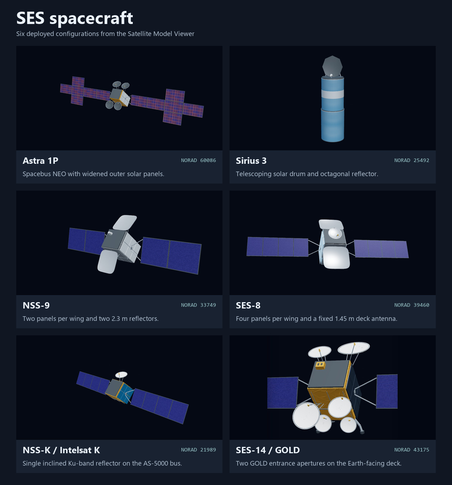

# SES fleet spacecraft models

The viewer now has revised exteriors for **38 spacecraft** and a corrected model assignment for **SES-1**. Those 39 spacecraft use 27 revised models and one previously reviewed model, each downloadable as a GLB or a Wavefront OBJ/MTL package. Of the 40 initial candidates, GStar 4 already had an illustrated RCA-family model scaled from GStar 4's own catalog dimensions. [GStar spacecraft illustration](https://space.skyrocket.de/doc_sdat/gstar-1.htm)

The inventory covers **120 in-orbit spacecraft** in the project's SES, Astra, AMC, NSS, O3b and joint-venture fleets, including inactive spacecraft and predecessors still tracked under another name. The tables also cover ten spacecraft from former regional affiliates and three partner spacecraft that supplied capacity. Aliases share one NORAD entry. Each number opens its spacecraft in the viewer. The operations column uses the project's catalog snapshot generated on 18 November 2026. The model review was completed on 25 November 2026. [SES fleet map](https://www.ses.com/sites/default/files/network_map/SES_FleetMap_RGB_25072024_Updated.pdf) · [SES 2002 annual report](https://www.ses.com/sites/default/files/2016-11/annual-report-02-en.pdf) · [SES affiliates](https://www.ses.com/company/about-us/our-affiliates) · [GCAT](https://planet4589.org/space/gcat/root.html)

## Revised exteriors and assignments

The solar wings, antennas and hosted instruments follow the linked flight or family illustrations. Model units are metres. The viewer's **GLB information** gives the dimensional source and indicates where the envelope, antenna sizes or minor fittings were estimated. The dates below are UTC launch dates. Masses are in kilograms, in launch / dry order. An ≈ marks a source estimate and a dash marks an unavailable value. Masses and dry masses come from GCAT unless a mission-specific record is cited. [GCAT](https://planet4589.org/space/gcat/root.html)

| Spacecraft | NORAD | Operations | Launch date | Launch / dry kg | Model decision | Reference |
| --- | --- | --- | --- | ---: | --- | --- |
| NSS-513 / Intelsat 513 | [19121](../display_satellite.html?norad=19121) | Inactive | 1988-05-17 | 1,978 / 884 | Added the Ford V-A communications tower, offset antennas and narrow solar wings. | [Archived spacecraft illustration](https://space.skyrocket.de/doc_sdat/intelsat-5a.htm) · [FCC record](https://docs.fcc.gov/public/attachments/DA-01-1426A1.pdf) · [FCC record](https://docs.fcc.gov/public/attachments/FCC-99-210A1.pdf) |
| Columbia 515 / Intelsat 515 | [19772](../display_satellite.html?norad=19772) | Inactive | 1989-01-27 | 1,981 / 884 | Added the Ford V-A communications tower, offset antennas and narrow solar wings. | [Archived spacecraft illustration](https://space.skyrocket.de/doc_sdat/intelsat-5a.htm) · [FCC record](https://docs.fcc.gov/public/attachments/DA-01-1426A1.pdf) |
| Sirius W / Marcopolo 1 | [20193](../display_satellite.html?norad=20193) | Unknown | 1989-08-27 | 1,233 / ≈500 | Built the Hughes 376 solar drum, broad thermal belt and raised silver reflector. | [Archived spacecraft illustration](https://space.skyrocket.de/doc_sdat/marco-polo.htm) |
| Satcom C1 | [20945](../display_satellite.html?norad=20945) | Unknown | 1990-11-20 | 1,169 / 485 | Added the AS-3000's single offset C-band aperture, projecting feed and three-panel wings. | [Archived spacecraft illustration](https://space.skyrocket.de/doc_sdat/satcom-5.htm) |
| Spacenet 4 / ASC 2 | [21227](../display_satellite.html?norad=21227) | Inactive | 1991-04-13 | 1,352 / ≈550 | Added the ASC bus proportions, a broad offset antenna and a smaller aperture. | [Archived spacecraft illustration](https://space.skyrocket.de/doc_sdat/asc-1.htm) |
| NSS-K / Intelsat K (NSS-101) | [21989](../display_satellite.html?norad=21989) | Inactive | 1992-06-10 | 2,900 / ≈1,300 | Added the AS-5000 body, open wing yokes and single inclined Ku-band aperture. | [Archived spacecraft illustration](https://space.skyrocket.de/doc_sdat/intelsat-k.htm) · [FCC record](https://docs.fcc.gov/public/attachments/FCC-99-210A1.pdf) |
| Satcom C4 | [22096](../display_satellite.html?norad=22096) | Inactive | 1992-08-31 | 1,402 / ≈590 | Added the AS-3000's single offset C-band aperture, projecting feed and three-panel wings. | [Archived spacecraft illustration](https://space.skyrocket.de/doc_sdat/satcom-5.htm) |
| Satcom C3 | [22117](../display_satellite.html?norad=22117) | Inactive | 1992-09-10 | 1,375 / 618 | Added the AS-3000's single offset C-band aperture, projecting feed and three-panel wings. | [Archived spacecraft illustration](https://space.skyrocket.de/doc_sdat/satcom-5.htm) |
| Astra 1C | [22653](../display_satellite.html?norad=22653) | Inactive | 1993-05-12 | 2,790 / 1,180 | Added the early Hughes 601 three-panel wings and paired broadcast reflectors. | [Archived spacecraft illustration](https://space.skyrocket.de/doc_sdat/astra-1c.htm) |
| Astra 1D | [23331](../display_satellite.html?norad=23331) | Inactive | 1994-11-01 | 2,924 / 1,250 | Added the early Hughes 601 three-panel wings and paired broadcast reflectors. | [Archived spacecraft illustration](https://space.skyrocket.de/doc_sdat/astra-1c.htm) |
| Astra 1E | [23686](../display_satellite.html?norad=23686) | Inactive | 1995-10-19 | 3,010 / 1,343 | Added the extended four-panel Hughes 601 wings and paired broadcast reflectors. | [Archived spacecraft illustration](https://space.skyrocket.de/doc_sdat/astra-1e.htm) |
| Astra 1F | [23842](../display_satellite.html?norad=23842) | Inactive | 1996-04-08 | 3,010 / ≈1,600 | Added the extended four-panel Hughes 601 wings and paired broadcast reflectors. | [Archived spacecraft illustration](https://space.skyrocket.de/doc_sdat/astra-1e.htm) |
| Nahuel 1A | [24714](../display_satellite.html?norad=24714) | Unknown | 1997-01-30 | 1,790 / 831 | Added the Spacebus 2000's white reflector pair, open yokes and four-panel wings. | [Archived spacecraft illustration](https://space.skyrocket.de/doc_sdat/nahuel-1.htm) |
| Astra 5A / Sirius 2 | [25049](../display_satellite.html?norad=25049) | Inactive | 1997-11-12 | 2,920 / 1,245 | Added four-panel wings and a three-antenna bank on the compact Spacebus 3000B2. | [Archived spacecraft illustration](https://space.skyrocket.de/doc_sdat/sirius-2.htm) |
| Astra 1G | [25071](../display_satellite.html?norad=25071) | Inactive | 1997-12-02 | 3,388 / ≈1,800 | Added contoured antennas, offset feeds and four-panel wings for the 601HP generation. | [Archived spacecraft illustration](https://space.skyrocket.de/doc_sdat/astra-1g.htm) |
| Astra 2A | [25462](../display_satellite.html?norad=25462) | Inactive | 1998-08-30 | ≈3,550 / ≈1,950 | Added contoured antennas, offset feeds and four-panel wings for the 601HP generation. | [Archived spacecraft illustration](https://space.skyrocket.de/doc_sdat/astra-1g.htm) |
| Sirius 3 | [25492](../display_satellite.html?norad=25492) | Inactive | 1998-10-05 | 1,420 / 597 | Built its octagonal reflector above the telescoping cylindrical solar array. | [Archived spacecraft illustration](https://space.skyrocket.de/doc_sdat/sirius-3.htm) |
| Astra 1H | [25785](../display_satellite.html?norad=25785) | Inactive | 1999-06-18 | 3,728 / ≈2,000 | Added contoured antennas, offset feeds and four-panel wings for the 601HP generation. | [Archived spacecraft illustration](https://space.skyrocket.de/doc_sdat/astra-1g.htm) |
| Astra 2B | [26494](../display_satellite.html?norad=26494) | Inactive | 2000-09-14 | 3,315 / ≈1,400 | Added its E2000+ wings, dark trim flap, two lateral reflectors and smaller deck antenna. | [Archived spacecraft illustration](https://space.skyrocket.de/doc_sdat/astra-2b.htm) |
| Astra 2D | [26638](../display_satellite.html?norad=26638) | Inactive | 2000-12-20 | 1,414 / ≈600 | Built the telescoping solar-cell drum, silver belt and raised despun reflector. | [Archived spacecraft illustration](https://space.skyrocket.de/doc_sdat/astra-2d.htm) |
| Astra 2C | [26853](../display_satellite.html?norad=26853) | Inactive | 2001-06-16 | 3,643 / ≈2,000 | Added contoured antennas, offset feeds and four-panel wings for the 601HP generation. | [Archived spacecraft illustration](https://space.skyrocket.de/doc_sdat/astra-1g.htm) |
| Astra 3A | [27400](../display_satellite.html?norad=27400) | Inactive | 2002-03-29 | 1,495 / ≈700 | Built the telescoping solar-cell drum, silver belt and raised despun reflector. | [Archived spacecraft illustration](https://space.skyrocket.de/doc_sdat/astra-2d.htm) |
| NSS-9 | [33749](../display_satellite.html?norad=33749) | Active | 2009-02-12 | 2,230 / 1,050 | Added two 2.3 m shaped reflectors, a global horn and two panels per wing. | [Manufacturer data sheet](https://sky-brokers.com/wp-content/uploads/2020/12/Datasheet-SES-NSS-9-Satellite-built-by-OSC.pdf) · [Archived spacecraft illustration](https://space.skyrocket.de/doc_sdat/nss-9.htm) |
| SES-7 / ProtoStar II | [34941](../display_satellite.html?norad=34941) | Active | 2009-05-16 | 3,905 / ≈2,000 | Rebuilt the silver two-section 601HP body with two large reflectors and two smaller apertures. | [ILS](https://www.ilslaunch.com/wp-content/uploads/2018/09/ProtoStar-II-MO-final.pdf) · [Archived spacecraft illustration](https://space.skyrocket.de/doc_sdat/indostar-2_protostar-2.htm) |
| SES-1 | [36516](../display_satellite.html?norad=36516) | Active | 2010-04-24 | 2,561 / ≈1,180 | Assignment corrected. Reused AMC-21's two 2.3 m dual-grid reflectors, four panels per wing and 22 m span. | [Manufacturer data sheet](https://sky-brokers.com/wp-content/uploads/2020/12/Datasheet-SES-12-3-Satellite-built-by-OSC.pdf) · [Manufacturer data sheet](https://sky-brokers.com/wp-content/uploads/2020/12/Datasheet-SES-AMC-21-Satellite-built-by-OSC.pdf) |
| Yahsat 1A / Al Yah 1 (YahLive) | [37393](../display_satellite.html?norad=37393) | Active | 2011-04-22 | 5,935 / ≈3,000 | Rebuilt the deep E3000 bus and offset white reflectors around the YahLive host. | [Archived spacecraft illustration](https://space.skyrocket.de/doc_sdat/yahsat-1a.htm) · [SES](https://www.ses.com/company/about-us/our-affiliates) |
| Astra 2F | [38778](../display_satellite.html?norad=38778) | Active | 2012-09-28 | 5,968 / 2,660 | Assigned the shared four-reflector broadcast configuration and long, narrow wings. | [Archived spacecraft illustration](https://space.skyrocket.de/doc_sdat/astra-2e.htm) · [SES launch announcement](https://cdn.ymaws.com/www.worldteleport.org/resource/resmgr/ASTRA2G_launch_announcement-.pdf) |
| SES-6 | [39172](../display_satellite.html?norad=39172) | Active | 2013-06-03 | 6,140 / ≈3,000 | Separated the long insulated bus and upper and lower reflector banks from the shared Eurostar outline. | [Archived spacecraft illustration](https://space.skyrocket.de/doc_sdat/ses-6.htm) |
| Astra 2E | [39285](../display_satellite.html?norad=39285) | Active | 2013-09-29 | 6,052 / ≈3,000 | Assigned the shared four-reflector broadcast configuration and long, narrow wings. | [Archived spacecraft illustration](https://space.skyrocket.de/doc_sdat/astra-2e.htm) · [SES launch announcement](https://cdn.ymaws.com/www.worldteleport.org/resource/resmgr/ASTRA2G_launch_announcement-.pdf) |
| SES-8 | [39460](../display_satellite.html?norad=39460) | Active | 2013-12-03 | 3,138 / ≈1,500 | Added two 2.5 × 2.7 m deployable reflectors, a 1.45 m fixed antenna and four panels per wing. | [Manufacturer data sheet](https://sky-brokers.com/wp-content/uploads/2020/12/Datasheet-SES-8-Satellite-built-by-OSC.pdf) · [Archived spacecraft illustration](https://space.skyrocket.de/doc_sdat/ses-8.htm) · [SpaceX launch kit](https://spaceflightnow.com/falcon9/007/ses8_presskit.pdf) |
| Astra 3C / Astra 5B | [39617](../display_satellite.html?norad=39617) | Active | 2014-03-22 | 5,724 / ≈3,000 | Rebuilt the asymmetric E3000 reflector bank and linked both flight names. | [Archived spacecraft illustration](https://space.skyrocket.de/doc_sdat/astra-5b.htm) · [Luxembourg registry](https://space-agency.public.lu/dam-assets/old-website/publications/2024/luxembourgregistryofspaceobjects-v8-may2024.pdf) · [SES launch record](https://sessd.com/gsr/press-release/astra-5b-will-offer-state-of-the-art-capacity-for-cee-russia-and-cis-from-31-5e/) |
| Astra 2G | [40364](../display_satellite.html?norad=40364) | Active | 2014-12-27 | 6,002 / ≈3,000 | Assigned the shared four-reflector broadcast configuration and long, narrow wings. | [Archived spacecraft illustration](https://space.skyrocket.de/doc_sdat/astra-2e.htm) · [SES launch announcement](https://cdn.ymaws.com/www.worldteleport.org/resource/resmgr/ASTRA2G_launch_announcement-.pdf) |
| SES-10 | [42432](../display_satellite.html?norad=42432) | Active | 2017-03-30 | 5,300 / ≈3,000 | Rebuilt the asymmetric reflector bank and added a trim flap on one solar wing. | [SES](https://www.ses.com/media-library/satellite-rendering) · [Airbus](https://www.airbus.com/en/newsroom/press-releases/2017-03-airbus-built-satellite-ses-10-successfully-launched) · [Archived spacecraft illustration](https://space.skyrocket.de/doc_sdat/ses-10.htm) |
| SES-11 / EchoStar 105 | [42967](../display_satellite.html?norad=42967) | Active | 2017-10-11 | 5,200 / ≈3,000 | Added the large lateral reflector pair, small lower aperture and one solar trim flap. | [Airbus](https://www.airbus.com/en/newsroom/press-releases/2017-09-airbus-ships-echostar-105ses-11-telecom-satellite-to-launch-base) · [SES](https://www.ses.com/media-library/satellite-rendering) · [Archived spacecraft illustration](https://space.skyrocket.de/doc_sdat/echostar-105-ses-11.htm) · [Airbus](https://www.airbus.com/en/newsroom/press-releases/2017-11-airbus-built-echostar-105ses-11-satellite-now-in-geostationary) |
| SES-14 / GOLD | [43175](../display_satellite.html?norad=43175) | Active | 2018-01-25 | 4,423 / ≈2,800 | Added the two GOLD optical apertures, mixed-size communications antennas and electric thruster arms. | [SES](https://www.ses.com/media-library/satellite-rendering) · [GOLD science team](https://gold.cs.ucf.edu/science-mission/gold-instrument/) · [Archived spacecraft illustration](https://space.skyrocket.de/doc_sdat/ses-14.htm) |
| GovSat-1 / SES-16 | [43178](../display_satellite.html?norad=43178) | Active | 2018-01-31 | ≈4,000 / ≈2,000 | Added the GEOStar-3 bus, silver radiator walls and dark, offset antenna bank. | [SES](https://www.ses.com/media-library/satellite-rendering) · [Archived spacecraft illustration](https://space.skyrocket.de/doc_sdat/ses-16.htm) · [GovSat](https://govsat.lu/news-events/ses-orders-new-satellite-in-joint-venture) |
| SES-12 | [43488](../display_satellite.html?norad=43488) | Active | 2018-06-04 | 5,384 / ≈3,000 | Added eight communications antennas and two electric thruster positioning arms. | [Archived spacecraft illustration](https://space.skyrocket.de/doc_sdat/ses-12.htm) · [Airbus](https://www.airbus.com/en/newsroom/press-releases/2018-06-airbus-built-ses-12-dual-mission-satellite-successfully-launched) |
| SES-22 | [52933](../display_satellite.html?norad=52933) | Active | 2022-06-29 | 3,500 / ≈2,000 | Added two dark C-band apertures and the straight blue wings of the Spacebus 4000B2. | [Archived spacecraft illustration](https://space.skyrocket.de/doc_sdat/ses-22.htm) · [SES](https://www.ses.com/press-release/ses-22-launch-june-29) |
| Astra 1P / SES-24 | [60086](../display_satellite.html?norad=60086) | Active | 2024-06-20 | ≈5,000 / ≈4,030 | Added the four dark broadcast reflectors and widened outer solar-array sections from Thales artwork. | [Thales Alenia Space](https://www.thalesaleniaspace.com/en/press-releases/astra-1p-communications-satellite-successfully-launched) · [Archived spacecraft illustration](https://space.skyrocket.de/doc_sdat/astra-1p.htm) |

SES lists Astra 5B's launch mass as 5,724 kg. ESA reports 5,755 kg for the same launch. The viewer uses the operator's figure. For SES-8, the viewer uses the launch provider's 3,138 kg. Orbital's design sheet quotes a rounded 3,200 kg. [SES Astra 5B launch record](https://sessd.com/gsr/press-release/astra-5b-will-offer-state-of-the-art-capacity-for-cee-russia-and-cis-from-31-5e/) · [ESA launch record](https://www.esa.int/Enabling_Support/Space_Transportation/Ariane_5_s_second_launch_of_2014) · [SpaceX SES-8 launch kit](https://spaceflightnow.com/falcon9/007/ses8_presskit.pdf) · [Orbital SES-8 data sheet](https://sky-brokers.com/wp-content/uploads/2020/12/Datasheet-SES-8-Satellite-built-by-OSC.pdf)

The model selection follows the NORAD identity even if a satellite's catalog orbit classification is unusual or unknown. GovSat-1 (43178) and NSS-K (21989) have flight-specific exteriors. The historical NSS entries include New Skies spacecraft. Columbia 515 belongs to the former Columbia/GE Americom fleet. [LuxGovSat](https://govsat.lu/news-events/ses-orders-new-satellite-in-joint-venture) · [New Skies FCC order](https://docs.fcc.gov/public/attachments/FCC-99-210A1.pdf) · [Columbia FCC order](https://docs.fcc.gov/public/attachments/DA-01-1426A1.pdf)

## Previously reviewed models

These 81 spacecraft already had a documented flight or family model. Shared geometry represents the cited configuration. The project has separate models for the 20 first-generation O3b spacecraft and the 13 Boeing-built O3b mPOWER spacecraft. The catalog lists Satcom K-2's operational status as unknown. SES records its retirement in 2002. [Arianespace O3b launch kit](https://assets.ctfassets.net/xuqkguafrpu1/4BFlD5uojWPMgD6YOl6yKe/918531b904a2403a5148b5bcc86d9078/O3b-SoyuzSTB_launch.pdf#page=5) · [SES O3b mPOWER gallery](https://www.ses.com/media-library/o3b-mpower) · [SES 2002 annual report](https://www.ses.com/sites/default/files/2016-11/annual-report-02-en.pdf)

Two retained models have a known limitation. SES-2 and SES-3 share an earlier STAR-2.4 model with unequal reflector sizes. Orbital specifies two 2.3 m reflectors for both flights, and SES-2 also carried the CHIRP hosted payload. The current SES-2 model omits the external CHIRP detail. [Orbital SES-1/2/3 data sheet](https://sky-brokers.com/wp-content/uploads/2020/12/Datasheet-SES-12-3-Satellite-built-by-OSC.pdf)

| Spacecraft | NORAD | Operations | Existing model | Reference |
| --- | --- | --- | --- | --- |
| Satcom K-2 | [16276](../display_satellite.html?norad=16276) | Unknown | AS4000 | [nasa.gov](https://www.nasa.gov/wp-content/uploads/2023/05/sts-61b-press-kit.pdf) |
| Astra 1A | [19688](../display_satellite.html?norad=19688) | Inactive | AS4000 | [Archived spacecraft illustration](https://space.skyrocket.de/doc_sdat/astra-1a.htm) |
| GStar 4 | [20946](../display_satellite.html?norad=20946) | Inactive | AS-3000 · GStar 4 dimensions | [Archived spacecraft illustration](https://space.skyrocket.de/doc_sdat/gstar-1.htm) |
| Astra 1B | [21139](../display_satellite.html?norad=21139) | Inactive | AS5000 | [Archived spacecraft illustration](https://space.skyrocket.de/doc_sdat/astra-1b.htm) |
| NSS-703 | [23305](../display_satellite.html?norad=23305) | Inactive | SSL 1300 | [Archived spacecraft illustration](https://space.skyrocket.de/doc_sdat/intelsat-7.htm) |
| AMC-1 (GE-1) | [24315](../display_satellite.html?norad=24315) | Inactive | Lockheed Martin A2100 | [Archived spacecraft illustration](https://space.skyrocket.de/doc_sdat/ge-1.htm) |
| AMC-2 (GE-2) | [24713](../display_satellite.html?norad=24713) | Inactive | Lockheed Martin A2100 | [Archived spacecraft illustration](https://space.skyrocket.de/doc_sdat/ge-1.htm) |
| AMC-3 | [24936](../display_satellite.html?norad=24936) | Inactive | Lockheed Martin A2100 | [Archived spacecraft illustration](https://space.skyrocket.de/doc_sdat/ge-1.htm) |
| NSS-5 / Intelsat 803 | [24957](../display_satellite.html?norad=24957) | Inactive | AS7000 | [Archived spacecraft illustration](https://space.skyrocket.de/doc_sdat/intelsat-8.htm) |
| NSS-806 | [25239](../display_satellite.html?norad=25239) | Inactive | AS7000 | [Archived spacecraft illustration](https://space.skyrocket.de/doc_sdat/intelsat-8a.htm) |
| AMC-5 (GE-5) | [25516](../display_satellite.html?norad=25516) | Inactive | Alcatel Spacebus 2000 | [Archived spacecraft illustration](https://space.skyrocket.de/doc_sdat/ge-5.htm) |
| AMC-4 (GE-4) | [25954](../display_satellite.html?norad=25954) | Inactive | Lockheed Martin A2100AX | [Archived spacecraft illustration](https://space.skyrocket.de/doc_sdat/ge-4.htm) |
| AMC-7 (GE-7) | [26495](../display_satellite.html?norad=26495) | Inactive | Lockheed Martin A2100A | [Archived spacecraft illustration](https://space.skyrocket.de/doc_sdat/ge-7.htm) |
| NSS-11 / AAP-1 | [26554](../display_satellite.html?norad=26554) | Active | A2100AX | [Archived spacecraft illustration](https://space.skyrocket.de/doc_sdat/ge-1a.htm) |
| AMC-6 | [26580](../display_satellite.html?norad=26580) | Active | Lockheed Martin A2100AX | [Archived spacecraft illustration](https://space.skyrocket.de/doc_sdat/ge-4.htm) |
| AMC-8 (GE-8) | [26639](../display_satellite.html?norad=26639) | Inactive | Lockheed Martin A2100A | [Archived spacecraft illustration](https://space.skyrocket.de/doc_sdat/ge-7.htm) |
| NSS-7 | [27414](../display_satellite.html?norad=27414) | Inactive | A2100 | [Archived spacecraft illustration](https://space.skyrocket.de/doc_sdat/nss-7.htm) |
| NSS-6 | [27603](../display_satellite.html?norad=27603) | Inactive | A2100AX | [Archived spacecraft illustration](https://space.skyrocket.de/doc_sdat/nss-6.htm) |
| AMC-9 (GE-12) | [27820](../display_satellite.html?norad=27820) | Inactive | Alcatel Spacebus 3000B3 | [Archived spacecraft illustration](https://space.skyrocket.de/doc_sdat/amc-9.htm) |
| AMC-10 (GE-10) | [28154](../display_satellite.html?norad=28154) | Inactive | Lockheed Martin A2100 | [Lockheed Martin](https://investors.lockheedmartin.com/news-releases/news-release-details/lockheed-martin-built-amc-10-satellite-launched-successfully/) |
| AMC-11 | [28252](../display_satellite.html?norad=28252) | Inactive | Lockheed Martin A2100 | [Archived spacecraft illustration](https://space.skyrocket.de/doc_sdat/ge-7.htm) |
| AMC-15 | [28446](../display_satellite.html?norad=28446) | Active | Lockheed Martin A2100 | [Archived spacecraft illustration](https://space.skyrocket.de/doc_sdat/amc-15.htm) |
| AMC-16 | [28472](../display_satellite.html?norad=28472) | Inactive | Lockheed Martin A2100 | [Archived spacecraft illustration](https://space.skyrocket.de/doc_sdat/amc-15.htm) |
| NSS-10 / AMC-12 | [28526](../display_satellite.html?norad=28526) | Active | Spacebus 4000C3 | [Archived spacecraft illustration](https://space.skyrocket.de/doc_sdat/amc-12.htm) |
| Eutelsat 174A / AMC-23 | [28924](../display_satellite.html?norad=28924) | Active | Alcatel Spacebus 4000C3 | [Archived spacecraft illustration](https://space.skyrocket.de/doc_sdat/amc-23.htm) |
| Astra 1KR | [29055](../display_satellite.html?norad=29055) | Active | A2100 | [Archived spacecraft illustration](https://space.skyrocket.de/doc_sdat/astra-1kr.htm) |
| AMC-18 | [29644](../display_satellite.html?norad=29644) | Inactive | Lockheed Martin A2100A | [Flight reference](https://sky-brokers.com/wp-content/uploads/2020/12/Arianespace-Launchkit-SES-AMC-18.pdf#page=8) |
| Astra 1L | [31306](../display_satellite.html?norad=31306) | Active | A2100 | [Archived spacecraft illustration](https://space.skyrocket.de/doc_sdat/astra-1l.htm) |
| Astra 4A / Sirius 4 | [32299](../display_satellite.html?norad=32299) | Active | A2100 | [Archived spacecraft illustration](https://space.skyrocket.de/doc_sdat/sirius-4.htm) |
| AMC-14 | [32708](../display_satellite.html?norad=32708) | Active | A2100AXS | [Lockheed Martin](https://news.lockheedmartin.com/2008-03-12-Lockheed-Martin-built-AMC-14-Satellite-Ready-for-Launch-From-Baikonur-Cosmodrome) |
| AMC-21 | [33275](../display_satellite.html?norad=33275) | Inactive | Orbital STAR-2 | [Manufacturer data sheet](https://sky-brokers.com/wp-content/uploads/2020/12/Datasheet-SES-AMC-21-Satellite-built-by-OSC.pdf) |
| Astra 1M | [33436](../display_satellite.html?norad=33436) | Active | Eurostar 3000S | [Archived spacecraft illustration](https://space.skyrocket.de/doc_sdat/astra-1m.htm) |
| Ciel-2 | [33453](../display_satellite.html?norad=33453) | Inactive | Spacebus 4000C4 | [ILS](https://www.ilslaunch.com/missions/ciel-ii/) |
| NSS-12 | [36032](../display_satellite.html?norad=36032) | Active | SSL 1300 | [Archived spacecraft illustration](https://space.skyrocket.de/doc_sdat/nss-12.htm) |
| Astra 3B | [36581](../display_satellite.html?norad=36581) | Active | Eurostar 3000M | [Archived spacecraft illustration](https://space.skyrocket.de/doc_sdat/astra-3b.htm) |
| SES-3 | [37748](../display_satellite.html?norad=37748) | Active | Star-2.4 · reflector discrepancy | [Manufacturer data sheet](https://sky-brokers.com/wp-content/uploads/2020/12/Datasheet-SES-12-3-Satellite-built-by-OSC.pdf) |
| Astra 1N | [37775](../display_satellite.html?norad=37775) | Active | Eurostar 3000M | [Archived spacecraft illustration](https://space.skyrocket.de/doc_sdat/astra-1n.htm) |
| SES-2 | [37809](../display_satellite.html?norad=37809) | Active | Star-2.4 · reflector discrepancy | [Manufacturer data sheet](https://sky-brokers.com/wp-content/uploads/2020/12/Datasheet-SES-12-3-Satellite-built-by-OSC.pdf) |
| QuetzSat 1 | [37826](../display_satellite.html?norad=37826) | Active | SSL 1300 | [Archived spacecraft illustration](https://space.skyrocket.de/doc_sdat/quetzsat-1.htm) |
| SES-4 | [38087](../display_satellite.html?norad=38087) | Active | SSL-1300S | [Archived spacecraft illustration](https://space.skyrocket.de/doc_sdat/ses-4.htm) |
| SES-5 / Sirius 5 | [38652](../display_satellite.html?norad=38652) | Active | SSL 1300 | [Archived spacecraft illustration](https://space.skyrocket.de/doc_sdat/ses-5.htm) |
| O3b FM5 | [39188](../display_satellite.html?norad=39188) | Active | O3b Classic | [Arianespace launch kit](https://assets.ctfassets.net/xuqkguafrpu1/4BFlD5uojWPMgD6YOl6yKe/918531b904a2403a5148b5bcc86d9078/O3b-SoyuzSTB_launch.pdf#page=5) |
| O3b FM4 | [39189](../display_satellite.html?norad=39189) | Active | O3b Classic | [Arianespace launch kit](https://assets.ctfassets.net/xuqkguafrpu1/4BFlD5uojWPMgD6YOl6yKe/918531b904a2403a5148b5bcc86d9078/O3b-SoyuzSTB_launch.pdf#page=5) |
| O3b FM2 | [39190](../display_satellite.html?norad=39190) | Active | O3b Classic | [Arianespace launch kit](https://assets.ctfassets.net/xuqkguafrpu1/4BFlD5uojWPMgD6YOl6yKe/918531b904a2403a5148b5bcc86d9078/O3b-SoyuzSTB_launch.pdf#page=5) |
| O3b PFM | [39191](../display_satellite.html?norad=39191) | Active | O3b Classic | [Arianespace launch kit](https://assets.ctfassets.net/xuqkguafrpu1/4BFlD5uojWPMgD6YOl6yKe/918531b904a2403a5148b5bcc86d9078/O3b-SoyuzSTB_launch.pdf#page=5) |
| O3b FM3 | [40079](../display_satellite.html?norad=40079) | Active | O3b Classic | [Arianespace launch kit](https://assets.ctfassets.net/xuqkguafrpu1/4BFlD5uojWPMgD6YOl6yKe/918531b904a2403a5148b5bcc86d9078/O3b-SoyuzSTB_launch.pdf#page=5) |
| O3b FM7 | [40080](../display_satellite.html?norad=40080) | Active | O3b Classic | [Arianespace launch kit](https://assets.ctfassets.net/xuqkguafrpu1/4BFlD5uojWPMgD6YOl6yKe/918531b904a2403a5148b5bcc86d9078/O3b-SoyuzSTB_launch.pdf#page=5) |
| O3b FM6 | [40081](../display_satellite.html?norad=40081) | Active | O3b Classic | [Arianespace launch kit](https://assets.ctfassets.net/xuqkguafrpu1/4BFlD5uojWPMgD6YOl6yKe/918531b904a2403a5148b5bcc86d9078/O3b-SoyuzSTB_launch.pdf#page=5) |
| O3b FM8 | [40082](../display_satellite.html?norad=40082) | Active | O3b Classic | [Arianespace launch kit](https://assets.ctfassets.net/xuqkguafrpu1/4BFlD5uojWPMgD6YOl6yKe/918531b904a2403a5148b5bcc86d9078/O3b-SoyuzSTB_launch.pdf#page=5) |
| O3b FM10 | [40348](../display_satellite.html?norad=40348) | Active | O3b Classic | [Arianespace launch kit](https://assets.ctfassets.net/xuqkguafrpu1/4BFlD5uojWPMgD6YOl6yKe/918531b904a2403a5148b5bcc86d9078/O3b-SoyuzSTB_launch.pdf#page=5) |
| O3b FM11 | [40349](../display_satellite.html?norad=40349) | Active | O3b Classic | [Arianespace launch kit](https://assets.ctfassets.net/xuqkguafrpu1/4BFlD5uojWPMgD6YOl6yKe/918531b904a2403a5148b5bcc86d9078/O3b-SoyuzSTB_launch.pdf#page=5) |
| O3b FM12 | [40350](../display_satellite.html?norad=40350) | Active | O3b Classic | [Arianespace launch kit](https://assets.ctfassets.net/xuqkguafrpu1/4BFlD5uojWPMgD6YOl6yKe/918531b904a2403a5148b5bcc86d9078/O3b-SoyuzSTB_launch.pdf#page=5) |
| O3b FM9 | [40351](../display_satellite.html?norad=40351) | Active | O3b Classic | [Arianespace launch kit](https://assets.ctfassets.net/xuqkguafrpu1/4BFlD5uojWPMgD6YOl6yKe/918531b904a2403a5148b5bcc86d9078/O3b-SoyuzSTB_launch.pdf#page=5) |
| SES-9 | [41380](../display_satellite.html?norad=41380) | Active | BSS-702HP | [SES](https://www.ses.com/media-library/satellite-rendering) |
| SES-15 | [42709](../display_satellite.html?norad=42709) | Active | BSS-702SP | [Boeing](https://boeing.mediaroom.com/01-09-15-Boeing-Completes-World-s-First-All-Electric-Propulsion-Satellites) |
| O3b FM15 | [43231](../display_satellite.html?norad=43231) | Active | O3b Classic | [Arianespace launch kit](https://assets.ctfassets.net/xuqkguafrpu1/4BFlD5uojWPMgD6YOl6yKe/918531b904a2403a5148b5bcc86d9078/O3b-SoyuzSTB_launch.pdf#page=5) |
| O3b FM16 | [43232](../display_satellite.html?norad=43232) | Active | O3b Classic | [Arianespace launch kit](https://assets.ctfassets.net/xuqkguafrpu1/4BFlD5uojWPMgD6YOl6yKe/918531b904a2403a5148b5bcc86d9078/O3b-SoyuzSTB_launch.pdf#page=5) |
| O3b FM14 | [43233](../display_satellite.html?norad=43233) | Active | O3b Classic | [Arianespace launch kit](https://assets.ctfassets.net/xuqkguafrpu1/4BFlD5uojWPMgD6YOl6yKe/918531b904a2403a5148b5bcc86d9078/O3b-SoyuzSTB_launch.pdf#page=5) |
| O3b FM13 | [43234](../display_satellite.html?norad=43234) | Active | O3b Classic | [Arianespace launch kit](https://assets.ctfassets.net/xuqkguafrpu1/4BFlD5uojWPMgD6YOl6yKe/918531b904a2403a5148b5bcc86d9078/O3b-SoyuzSTB_launch.pdf#page=5) |
| O3b FM20 | [44112](../display_satellite.html?norad=44112) | Active | O3b Classic | [Arianespace launch kit](https://assets.ctfassets.net/xuqkguafrpu1/4BFlD5uojWPMgD6YOl6yKe/918531b904a2403a5148b5bcc86d9078/O3b-SoyuzSTB_launch.pdf#page=5) |
| O3b FM19 | [44113](../display_satellite.html?norad=44113) | Active | O3b Classic | [Arianespace launch kit](https://assets.ctfassets.net/xuqkguafrpu1/4BFlD5uojWPMgD6YOl6yKe/918531b904a2403a5148b5bcc86d9078/O3b-SoyuzSTB_launch.pdf#page=5) |
| O3b FM17 | [44114](../display_satellite.html?norad=44114) | Active | O3b Classic | [Arianespace launch kit](https://assets.ctfassets.net/xuqkguafrpu1/4BFlD5uojWPMgD6YOl6yKe/918531b904a2403a5148b5bcc86d9078/O3b-SoyuzSTB_launch.pdf#page=5) |
| O3b FM18 | [44115](../display_satellite.html?norad=44115) | Active | O3b Classic | [Arianespace launch kit](https://assets.ctfassets.net/xuqkguafrpu1/4BFlD5uojWPMgD6YOl6yKe/918531b904a2403a5148b5bcc86d9078/O3b-SoyuzSTB_launch.pdf#page=5) |
| SES-17 | [49332](../display_satellite.html?norad=49332) | Active | Thales Alenia Space Spacebus NEO 200 | [Flight reference](https://sky-brokers.com/satellite/ses-17-at-67-west/) |
| SES-20 | [53960](../display_satellite.html?norad=53960) | Active | BSS-702SP | [SES](https://www.ses.com/media-library/ses2021-media-gallery) |
| SES-21 | [53961](../display_satellite.html?norad=53961) | Active | BSS-702SP | [SES](https://www.ses.com/media-library/ses2021-media-gallery) |
| O3b mPOWER F1 | [54755](../display_satellite.html?norad=54755) | Active | O3b mPOWER | [SES](https://www.ses.com/media-library/o3b-mpower) |
| O3b mPOWER F2 | [54756](../display_satellite.html?norad=54756) | Active | O3b mPOWER | [SES](https://www.ses.com/media-library/o3b-mpower) |
| SES-18 | [55970](../display_satellite.html?norad=55970) | Active | Geostar-3 | [Archived spacecraft illustration](https://space.skyrocket.de/doc_sdat/ses-18.htm) |
| SES-19 | [55971](../display_satellite.html?norad=55971) | Active | Geostar-3 | [Archived spacecraft illustration](https://space.skyrocket.de/doc_sdat/ses-18.htm) |
| O3b mPOWER F4 | [56367](../display_satellite.html?norad=56367) | Active | O3b mPOWER | [SES](https://www.ses.com/media-library/o3b-mpower) |
| O3b mPOWER F3 | [56368](../display_satellite.html?norad=56368) | Active | O3b mPOWER | [SES](https://www.ses.com/media-library/o3b-mpower) |
| O3b mPOWER F5 | [58346](../display_satellite.html?norad=58346) | Active | O3b mPOWER | [SES](https://www.ses.com/media-library/o3b-mpower) |
| O3b mPOWER F6 | [58347](../display_satellite.html?norad=58347) | Active | O3b mPOWER | [SES](https://www.ses.com/media-library/o3b-mpower) |
| O3b mPOWER F7 | [62362](../display_satellite.html?norad=62362) | Active | O3b mPOWER | [SES](https://www.ses.com/media-library/o3b-mpower) |
| O3b mPOWER F8 | [62363](../display_satellite.html?norad=62363) | Active | O3b mPOWER | [SES](https://www.ses.com/media-library/o3b-mpower) |
| O3b mPOWER F9 | [64866](../display_satellite.html?norad=64866) | Active | O3b mPOWER | [SES](https://www.ses.com/media-library/o3b-mpower) |
| O3b mPOWER F10 | [64867](../display_satellite.html?norad=64867) | Active | O3b mPOWER | [SES](https://www.ses.com/media-library/o3b-mpower) |
| O3b mPOWER F11 | [100686](../display_satellite.html?norad=100686) | Active | O3b mPOWER | [SES](https://www.ses.com/media-library/o3b-mpower) |
| O3b mPOWER F12 | [100687](../display_satellite.html?norad=100687) | Active | O3b mPOWER | [SES](https://www.ses.com/media-library/o3b-mpower) |
| O3b mPOWER F13 | [100688](../display_satellite.html?norad=100688) | Active | O3b mPOWER | [SES](https://www.ses.com/media-library/o3b-mpower) |

## Former regional affiliates

SES held interests in AsiaSat and Star One until 2007. Ten spacecraft were in those companies' fleets during the period of SES participation and still have catalog entries in orbit. Their existing models use published flight or family references. Brasilsat A1 was leased to PanAmSat before it entered a disposal orbit in 2002. [SES 2002 fleet](https://www.ses.com/sites/default/files/2016-11/annual-report-02-en.pdf) · [SES 2006 annual report](https://www.ses.com/sites/default/files/2016-11/annual-report-06-en.pdf) · [Brazilian registration and disposal record](https://www.unoosa.org/documents/pdf/ser678E.pdf)

| Spacecraft | NORAD | Operations | Existing model | Reference |
| --- | --- | --- | --- | --- |
| Brasilsat A1 | [15561](../display_satellite.html?norad=15561) | Inactive | HS-376 | [Archived spacecraft illustration](https://space.skyrocket.de/doc_sdat/westar-4.htm) |
| Brasilsat A2 | [16650](../display_satellite.html?norad=16650) | Inactive | HS-376 | [Archived spacecraft illustration](https://space.skyrocket.de/doc_sdat/westar-4.htm) |
| AsiaSat 1 | [20558](../display_satellite.html?norad=20558) | Inactive | HS-376 | [Archived spacecraft illustration](https://space.skyrocket.de/doc_sdat/westar-4.htm) |
| Brasilsat B1 | [23199](../display_satellite.html?norad=23199) | Inactive | HS-376W | [Archived spacecraft illustration](https://space.skyrocket.de/doc_sdat/brasilsat-b.htm) |
| Brasilsat B2 | [23536](../display_satellite.html?norad=23536) | Inactive | HS-376W | [Archived spacecraft illustration](https://space.skyrocket.de/doc_sdat/brasilsat-b.htm) |
| AsiaSat 2 / AMOS-5i | [23723](../display_satellite.html?norad=23723) | Inactive | AS7000 | [Archived spacecraft illustration](https://space.skyrocket.de/doc_sdat/asiasat-2.htm) |
| Brasilsat B3 | [25152](../display_satellite.html?norad=25152) | Inactive | HS-376W | [Archived spacecraft illustration](https://space.skyrocket.de/doc_sdat/brasilsat-b.htm) |
| AsiaSat 3S | [25657](../display_satellite.html?norad=25657) | Inactive | HS-601HP | [boeing.com](https://www.boeing.com/content/dam/boeing/v2/company/history/pdf/Boeing_Products.pdf#page=179) |
| Brasilsat B4 | [26469](../display_satellite.html?norad=26469) | Inactive | HS-376W | [Archived spacecraft illustration](https://space.skyrocket.de/doc_sdat/brasilsat-b.htm) |
| AsiaSat 4 | [27718](../display_satellite.html?norad=27718) | Active | HS-601HP | [boeing.com](https://www.boeing.com/content/dam/boeing/v2/company/history/pdf/Boeing_Products.pdf#page=179) |

## Capacity partnerships

| Spacecraft | NORAD | Decision | Reference |
| --- | --- | --- | --- |
| TDRS 5 | [21639](../display_satellite.html?norad=21639) | NASA relay spacecraft with C-band capacity marketed by Columbia. Both retain the existing TDRS model. | [FCC authorization](https://docs.fcc.gov/public/attachments/DA-01-2100A1.pdf) · [NASA spacecraft generations](https://www.nasa.gov/missions/tdrs/tracking-and-data-relay-satellite-tdrs-generations-of-spacecraft/) |
| TDRS 6 | [22314](../display_satellite.html?norad=22314) | NASA relay spacecraft with C-band capacity marketed by Columbia. Both retain the existing TDRS model. | [FCC authorization](https://docs.fcc.gov/public/attachments/DA-01-2100A1.pdf) · [NASA spacecraft generations](https://www.nasa.gov/missions/tdrs/tracking-and-data-relay-satellite-tdrs-generations-of-spacecraft/) |
| TürkmenÄlem 52°E / MonacoSAT | [40617](../display_satellite.html?norad=40617) | SSI-Monaco commercializes a payload on the Turkmen spacecraft and supplies capacity to SES. The existing model represents the Spacebus 4000C2. | [SSI-Monaco](https://www.ssi-monaco.com/overview/) · [Archived spacecraft illustration](https://space.skyrocket.de/doc_sdat/turkmenalem-52e.htm) |
